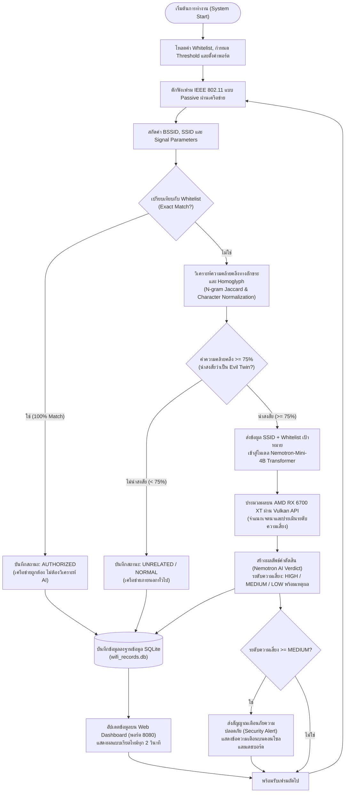

# แบบเสนอหัวข้อโครงงานวิศวกรรม (QF-17)
## ระบบตรวจจับ Evil Twin Access Point ด้วยการวิเคราะห์ Beacon Frame และโมเดลปัญญาประดิษฐ์ Nemotron-Mini-4B Transformer

---

### 1. ที่มาของโครงงาน
ปัจจุบันเครือข่ายไร้สาย (Wi-Fi) ได้กลายเป็นโครงสร้างพื้นฐานสำคัญสำหรับการสื่อสารทั้งในสถาบันการศึกษาและองค์กรภาครัฐและเอกชน อย่างไรก็ตาม ความแพร่หลายดังกล่าวได้นำมาซึ่งความเสี่ยงด้านความมั่นคงปลอดภัยไซเบอร์ โดยเฉพาะอย่างยิ่งการโจมตีในรูปแบบ **Evil Twin Attack (จุดกระจายสัญญาณแฝง)** ซึ่งผู้โจมตีสร้าง Access Point (AP) ปลอมขึ้นมาโดยกำหนดชื่อเครือข่าย (SSID) และคุณลักษณะของเฟรมสัญญาณให้เหมือนหรือใกล้เคียงกับเครือข่ายจริงขององค์กร เพื่อหลอกล่อให้อุปกรณ์ของผู้ใช้งานเชื่อมต่อโดยอัตโนมัติ ส่งผลให้ผู้โจมตีสามารถดักรับข้อมูลสำคัญ (Eavesdropping), ขโมยข้อมูลระบุตัวตน (Credential Harvesting) ผ่านหน้าต่าง Captive Portal ปลอม และกระทำการโจมตีในลักษณะ Man-in-the-Middle (MitM) ได้

จากการศึกษาวิจัยและทดลองในระยะแรก การใช้เทคนิคการจับคู่อักขระพื้นฐานหรือโมเดลภาษาขนาดเล็กกลุ่ม Dense Embedding เช่น **MiniLM (ประมาณ 22–33 ล้านพารามิเตอร์)** เพื่อคำนวณระยะห่างเชิงความหมาย (Cosine Similarity) ของชื่อ SSID พบข้อจำกัดสำคัญในทางปฏิบัติ เนื่องจากชื่อ SSID มีความยาวสั้นและประกอบด้วยคำสำคัญซ้ำ ๆ ส่งผลให้โมเดล MiniLM ไม่สามารถจำแนกความแตกต่างเชิงเจตนา (Semantic Intent) ได้ เช่น การประเมินชื่อ `Company_Staff_Secure` เทียบกับ `Company_Guest_WiFi` ซึ่งเป็นเครือข่ายทางการที่ถูกกฎหมายทั้งคู่ แต่กลับมีค่าความคล้ายคลึงสูงจนเกิดสัญญาณเตือนผิดพลาด (False Positive) ขณะเดียวกันกลับไม่สามารถตรวจจับการปลอมแปลงแบบแนบเนียนที่มีการดัดแปลงคำหรือเติมคำเฉพาะ เช่น `Company_Staff_Login` หรือการใช้เทคนิคตัวอักษรพ้องรูป (Homoglyph) ได้อย่างมีนัยสำคัญ

ดังนั้น โครงงานนี้จึงได้รับการพัฒนาและยกระดับขึ้นโดยนำโมเดลภาษาขนาดเล็กตระกูล Transformer ขั้นสูง **NVIDIA Nemotron-Mini-4B-Instruct (4.1 พันล้านพารามิเตอร์)** ซึ่งผ่านกระบวนการ Pruning และ Knowledge Distillation ร่วมกับการทำงานแบบ Multi-Tier Architecture มาประยุกต์ใช้ในการวิเคราะห์เจตนาและจำแนกความเสี่ยงของ Access Point ผสานร่วมกับการตรวจสอบความผิดปกติทางกายภาพของ Wi-Fi Management Frame (Beacon Frame, RSSI Volatility, Timing Jitter) และเร่งความเร็วการประมวลผลด้วย **Vulkan Compute API บนหน่วยประมวลผลกราฟิก (GPU)** เพื่อให้ระบบสามารถจำแนกและแจ้งเตือนภัยคุกคาม Evil Twin ได้อย่างแม่นยำ เรียลไทม์ และมีเสถียรภาพสูง

---

### 2. คำสำคัญ (Keywords)
* ระบบตรวจจับ Evil Twin / Evil Twin Detection System
* ความปลอดภัยเครือข่ายไร้สาย / Wireless Network Security
* เฟรมบีคอน / Beacon Frame Analysis
* โมเดลภาษาปัญญาประดิษฐ์ขนาดเล็ก / Small Language Model (SLM)
* เนโมตรอน ทรานส์ฟอร์เมอร์ / Nemotron-Mini-4B Transformer
* การวิเคราะห์เจตนาเชิงความหมาย / Semantic Intent Reasoning
* การเร่งความเร็วด้วยวัลแคน / Vulkan GPU Acceleration
* อุปกรณ์ตรวจจับที่ขอบเครือข่าย / Edge Sensor Monitoring

---

### 3. วัตถุประสงค์ในการทำโครงงาน
1. เพื่อออกแบบและพัฒนาระบบตรวจจับ Evil Twin Access Point ในเครือข่ายไร้สายที่มีความแม่นยำสูงและลดอัตราการแจ้งเตือนผิดพลาด (False Positive Rate)
2. เพื่อประยุกต์ใช้โมเดลปัญญาประดิษฐ์ **Nemotron-Mini-4B Transformer** ในการจำแนกเจตนาและรูปแบบการเลียนแบบชื่อเครือข่าย (SSID Impersonation & Typosquatting)
3. เพื่อศึกษากระบวนการวิเคราะห์ความผิดปกติของ Wi-Fi Management Frame (Beacon Frame, Sequence Number, BSSID, RSSI) ร่วมกับข้อมูลเชิงภาษา
4. เพื่อพัฒนาสถาปัตยกรรม Edge-Central Offloading ที่ให้อุปกรณ์ Edge Sensor (Raspberry Pi / Kali Linux) ใช้ทรัพยากรหน่วยความจำต่ำ (< 30 MB) โดยส่งต่อภาระการประมวลผลโมเดล AI ไปยังเครื่องประมวลผลหลักผ่าน REST API
5. เพื่อสร้างระบบแดชบอร์ดแสดงผลแบบเรียลไทม์ (Web-based Monitoring Dashboard) พร้อมระบบจัดเก็บข้อมูลเชิงนิติวิทยาศาสตร์ไซเบอร์ (Forensic SQLite Database)

---

### 4. ขอบเขตความสามารถของโครงงาน
1. **การตรวจจับสัญญาณไร้สาย (Passive Sensing):**
   * รองรับการดักฟังเฟรมสัญญาณ Wi-Fi แบบ Passive ตรวจจับคลื่นความถี่ 2.4 GHz และ 5 GHz (มาตรฐาน IEEE 802.11 a/b/g/n/ac)
   * ดักจับและวิเคราะห์ Management Frames โดยเฉพาะ Beacon Frame และ Probe Request/Response ในระยะตรวจจับ 30–50 เมตร
2. **การสกัดคุณลักษณะ (Feature Extraction):**
   * สกัดข้อมูล BSSID (MAC Address), SSID, ช่องสัญญาณ (Channel), ความแรงของสัญญาณ (RSSI), และ Security Capabilities
3. **การจำแนกความเสี่ยงแบบหลายระดับ (Multi-Tier Detection Pipeline):**
   * **Tier 1 (Whitelist Exact Match):** ตรวจสอบกับรายการ Authorized AP อย่างรวดเร็วด้วยเวลา $O(1)$
   * **Tier 2 (Fast Homoglyph & Typosquatting Filter):** คัดกรองอักขระพ้องรูป (เช่น เลข `1` แทน `l`, เลข `0` แทน `o`) และความคล้ายคลึงของ N-gram เบื้องต้น
   * **Tier 3 (Neural Transformer Reasoning):** ส่งต่อ SSID ที่มีความน่าสงสัยเข้าสู่โมเดล **Nemotron-Mini-4B** เพื่อประเมินเจตนาการเลียนแบบและระบุระดับความเสี่ยง (HIGH / MEDIUM / LOW) พร้อมคำอธิบายเหตุผล
   * **Tier 4 (Physical Beacon Anomaly):** ประเมินร่วมกับความผันผวนของ RSSI (Volatility), ข้อมูล Vendor OUI และ Sequence Number Deviation
4. **การแสดงผลและบันทึกข้อมูล:**
   * บันทึกประวัติการตรวจจับลงในฐานข้อมูล SQLite แบบอัตโนมัติ
   * แสดงผลรายการ AP ทั้งหมดแบบเรียลไทม์ผ่าน Web Dashboard ที่รีเฟรชข้อมูลทุก 2 วินาที

---

### 5. เครื่องมือ, เครื่องวัด และอุปกรณ์ที่ใช้

#### 5.1 ด้านฮาร์ดแวร์ (Hardware)
1. **Edge Sensor Node:**
   * บอร์ดประมวลผล Raspberry Pi 4 Model B หรือ Raspberry Pi 5 (สถาปัตยกรรม ARM64)
   * การ์ดเครือข่ายไร้สาย USB Wi-Fi Adapter ที่รองรับ Monitor Mode และ Packet Injection
2. **Central Processing & Acceleration Host:**
   * คอมพิวเตอร์ประมวลผลหลัก (PC / Workstation)
   * หน่วยประมวลผลกราฟิก (GPU): **AMD Radeon RX 6700 XT (12 GB GDDR6 VRAM)** สำหรับประมวลผลโมเดล Nemotron ผ่าน Vulkan API
   * หน่วยความจำหลัก (RAM): 16 GB DDR4/DDR5
   * พื้นที่จัดเก็บข้อมูล: Solid State Drive (SSD)

#### 5.2 ด้านซอฟต์แวร์ (Software)
1. **ระบบปฏิบัติการ:** Kali Linux (ARM64) บนอุปกรณ์ตรวจจับ และ Windows 11 / Ubuntu บนเครื่องประมวลผลหลัก
2. **คอนเทนเนอร์และระบบจำลอง:** Docker Engine และ Docker Compose สำหรับจำลองสภาพแวดล้อมเครือข่ายจำลองและทดสอบการกระจายสัญญาณเฟรม
3. **เครื่องมือเครือข่าย:** Scapy (Python Packet Manipulation), Kismet, Wireshark
4. **แพลตฟอร์มปัญญาประดิษฐ์และรันไทม์:**
   * **NVIDIA Nemotron-Mini-4B-Instruct** (ฟอร์แมต GGUF Q4_K_M)
   * **llama.cpp Vulkan Inference Server** (ให้บริการ OpenAI-compatible REST API บนพอร์ต 1234)
   * Python 3.10+ พร้อมโมดูล Requests, SQLite3, Sockets

---

### 6. แนวคิด หลักการ และทฤษฎีที่เกี่ยวข้อง

#### 6.1 การโจมตีแบบ Evil Twin Attack
Evil Twin Attack คือการโจมตีที่ผู้ไม่หวังดีจัดตั้งจุดเชื่อมต่อไร้สายปลอม (Rogue AP) ขึ้นในบริเวณใกล้เคียงกับเครือข่ายเป้าหมาย โดยตั้งค่า SSID และพารามิเตอร์ของเครือข่ายให้เลียนแบบเครือข่ายที่ถูกต้อง ผู้โจมตีมักส่งเฟรมตัดการเชื่อมต่อ (Deauthentication Frame) ซ้ำ ๆ ไปยังเครื่องลูกข่าย เพื่อบังคับให้อุปกรณ์หลุดออกจาก AP ตัวจริง เมื่ออุปกรณ์ลูกข่ายพยายามค้นหาและเชื่อมต่อใหม่ มักจะเลือกเชื่อมต่อกับ Rogue AP ที่มีค่ากำลังส่งสัญญาณ (RSSI) สูงกว่าโดยอัตโนมัติ ทำให้ผู้โจมตีเข้าควบคุมช่องทางการสื่อสารได้โดยสมบูรณ์

#### 6.2 โครงสร้างเฟรม IEEE 802.11 Management Frame
* **Beacon Frame:** เป็นเฟรมย่อยที่ Access Point กระจายออกมาอย่างสม่ำเสมอ (โดยทั่วไปทุก 100 ms) ภายในเฟรมบรรจุ Information Elements (IE) ที่สำคัญ เช่น SSID, Supported Rates, DS Parameter Set (Channel), RSN Information (Encryption)
* **Probe Request / Response:** ใช้สำหรับกระบวนการค้นหาเครือข่าย (Active Scanning) ซึ่งอาจตกเป็นเป้าหมายของการโจมตีแบบ KARMA Attack

#### 6.3 ข้อจำกัดของโมเดล MiniLM และเหตุผลที่ต้องพัฒนาสู่ Nemotron-Mini-4B
ในงานวิจัยระยะแรก มีการนำโมเดล **all-MiniLM-L6-v2** ซึ่งเป็น Bi-Encoder Transformer ขนาดเล็ก (~22–33 ล้านพารามิเตอร์) มาใช้วัดระยะห่างโคไซน์ (Cosine Similarity) ของชื่อ SSID อย่างไรก็ตาม พบข้อจำกัดทางวิชาการและเทคนิคที่สำคัญดังนี้:
1. **การสูญเสียบริบทของคำสั้น (Short Text Collapse):** MiniLM ถูกฝึกฝนด้วยชุดข้อมูลประโยคขนาดยาว (Natural Language Sentences) เมื่อนำมาใช้กับสตริง SSID ที่มีความยาวเฉลี่ยเพียง 10–25 ตัวอักษร เวกเตอร์ Embedding มักกระจุกตัว ทำให้คำศัพท์ที่มีส่วนทับซ้อนกันเพียงเล็กน้อยได้รับคะแนนความคล้ายคลึงสูงเกินจริง
2. **ไม่สามารถแยกแยะบทบาทของคำ (Role Conflation):** เช่น `Company_Staff` และ `Company_Guest` ได้รับคะแนนความคล้ายคลึงสูงกว่า 0.80 เนื่องจากแชร์คำว่า `Company` ร่วมกัน ทำให้ระบบแจ้งเตือนว่าเป็น Evil Twin ทั้งที่เป็นเครือข่ายที่ถูกกฎหมาย
3. **ขาดความสามารถในการคิดวิเคราะห์เชิงเหตุผล (Lack of Reasoning):** โมเดลประเภท Embedding ให้ผลลัพธ์เป็นเพียงตัวเลขระยะห่างเวกเตอร์ แต่ไม่สามารถวิเคราะห์และอธิบายได้ว่า *ทำไม* ชื่อดังกล่าวจึงเป็นภัยคุกคาม (เช่น การระบุว่ามีคีย์เวิร์ด `Login` หรือ `Free` เสริมเข้ามาเพื่อล่อลวง)

#### 6.4 สถาปัตยกรรม NVIDIA Nemotron-Mini-4B Transformer
**Nemotron-Mini-4B-Instruct** เป็นโมเดลภาษาขนาดเล็ก (Small Language Model - SLM) ขนาด 4.1 พันล้านพารามิเตอร์ ที่พัฒนาโดย NVIDIA ผ่านกระบวนการ:
* **Structured Pruning & Knowledge Distillation:** ย่อขนาดลงมาจากโมเดลหลัก Nemotron-4 15B โดยตัดแต่งมิติความลึก (Depth) และความกว้าง (Width) ของ Transformer Layers ทำให้มีขนาดกะทัดรัดแต่คงความแม่นยำสูง
* **Decoder-Only Transformer:** มีกลไก Self-Attention ที่สามารถทำความเข้าใจโครงสร้างประโยค ความสัมพันธ์ของคำเฉพาะ และการใช้ตัวอักษรทดแทนได้อย่างลึกซึ้ง
* **Agentic Reasoning & Output Structure:** สามารถประเมินบริบทของ SSID เปรียบเทียบกับ Whitelist และสรุประดับความเสี่ยง (Risk Level) พร้อมเหตุผลประกอบภาษาธรรมชาติได้อย่างกระชับ

#### 6.5 การเร่งความเร็วด้วย Vulkan Compute API บนสถาปัตยกรรม AMD RDNA2
หน่วยประมวลผลกราฟิก AMD Radeon RX 6700 XT (สถาปัตยกรรม Navi 22 / `gfx1031`) มีข้อจำกัดด้านความเข้ากันได้กับชุดพัฒนา ROCm บนระบบปฏิบัติการ Windows การนำ **Vulkan Backend** ของ `llama.cpp` มาใช้จึงเป็นทางออกที่ตอบโจทย์อย่างยิ่ง เนื่องจาก:
* ทำงานเป็น Cross-Platform Graphics & Compute API ระดับ Low-level ที่ทำงานได้โดยตรงกับไดรเวอร์ AMD Adrenalin
* สามารถออฟโหลดเลเยอร์ทั้งหมดของโมเดล (99 Layers) ลงสู่ VRAM 12 GB ได้ 100%
* ให้ความเร็วในการประมวลผลสูงถึง **43.4 tokens/วินาที** โดยไม่มีปัญหาไดรเวอร์แครชหรือข้อจำกัดด้านสถาปัตยกรรม

---

### 7. ขั้นตอนการดำเนินงานและการทดลอง

#### รายละเอียดขั้นตอนการทำงาน:
1. **การเริ่มต้นระบบ:** ระบบโหลดข้อมูลเครือข่ายที่ได้รับอนุญาต (`whitelist.json`), กำหนดค่าความคล้ายคลึงเกณฑ์ต่ำสุดที่ 75% และเริ่มบริการฐานข้อมูล SQLite และ Web Dashboard บนพอร์ต 8080
2. **การดักจับเฟรม (Packet Sniffing):** รับข้อมูลเฟรม 802.11 แบบเรียลไทม์ และแยกแยะข้อมูลประเภท Management Frame เพื่อคัดแยกค่า BSSID และ SSID
3. **การกรองขั้นที่ 1 (Whitelist Exact Match):** หาก SSID ตรงกับรายการ Whitelist ทุกตัวอักษร จะกำหนดสถานะเป็น `AUTHORIZED` ทันทีเพื่อประหยัดทรัพยากรการประมวลผล
4. **การกรองขั้นที่ 2 (Homoglyph & Typosquatting Analysis):** สำหรับ SSID ที่ไม่ตรงกับ Whitelist ระบบจะแปลงอักขระเสี่ยง (เช่น เปลี่ยน `-` เป็น `_`, เปลี่ยน `1` เป็น `l`, เปลี่ยน `0` เป็น `o`) แล้วคำนวณสัดส่วน 2-gram Jaccard Similarity หากได้คะแนน $\ge 0.75$ จะถูกจัดเป็นเคสต้องสงสัยทันที
5. **การวิเคราะห์ขั้นที่ 3 ด้วย Nemotron-Mini-4B:** เคสที่น่าสงสัยจะถูกส่งต่อไปยังโมเดล Nemotron-Mini-4B ผ่าน HTTP REST API เพื่อวิเคราะห์ว่าชื่อดังกล่าวมีเจตนาปลอมแปลง เลียนแบบ หรือล่อลวงผู้ใช้หรือไม่ โมเดลจะให้คำตัดสิน (Verdict) เป็นระดับความเสี่ยง (HIGH, MEDIUM, LOW) พร้อมระบุเหตุผลประกอบ
6. **การบันทึกผลและแสดงผล:** บันทึกข้อมูลและคำตัดสินลงฐานข้อมูล SQLite และส่งต่อข้อมูลไปยัง Web Dashboard เพื่อให้ผู้ดูแลระบบตรวจสอบได้แบบเรียลไทม์

---

### 8. ประโยชน์ที่คาดว่าจะได้รับ
1. **ลดอัตราการแจ้งเตือนผิดพลาด (False Positive):** ด้วยความสามารถของ Nemotron-Mini-4B ทำให้ระบบแยกแยะความแตกต่างระหว่างเครือข่ายสาขาที่ถูกกฎหมายกับเครือข่ายปลอมแปลงได้อย่างแม่นยำกว่าการใช้โมเดล Embedding ขนาดเล็กแบบเดิม
2. **เพิ่มความโปร่งใสในการตัดสินใจด้านความปลอดภัย (Explainable AI):** ระบบไม่เพียงแต่บอกค่าตัวเลขความคล้ายคลึง แต่ยังให้เหตุผลเป็นภาษาธรรมชาติว่าทำไม SSID นั้นจึงน่าสงสัย ช่วยให้ผู้ดูแลระบบตัดสินใจระงับเหตุได้อย่างรวดเร็ว
3. **ประหยัดงบประมาณและรองรับการทำงานต่อเนื่อง (Cost-Effective & Sustainable):** การประมวลผลแบบ Local Inference บน GPU ของเครื่องคอมพิวเตอร์ผ่าน Vulkan API ช่วยให้ระบบทำงานได้ฟรี 100% ตลอดเวลา โดยไม่ต้องพึ่งพาคลาวด์ API ที่มีค่าใช้จ่ายหรือจำกัดโควตา
4. **ความยืดหยุ่นในการติดตั้งใช้งาน (Edge-Ready Architecture):** ตัวเซนเซอร์ใช้หน่วยความจำต่ำมาก (< 30 MB) ทำให้สามารถนำไปติดตั้งบนอุปกรณ์ประหยัดพลังงาน เช่น Raspberry Pi เพื่อกระจายตรวจจับทั่วอาคารได้อย่างมีประสิทธิภาพ

---

### 9. งานวิจัยและเอกสารอ้างอิง (References)

1. NVIDIA Corporation. (2024). *Nemotron-Mini-4B-Instruct: A Compact Language Model for On-Device and Edge AI*. NVIDIA Developer Documentation. https://huggingface.co/nvidia/Nemotron-Mini-4B-Instruct
2. Wang, H., et al. (2024). *Minitron: Compact Language Models via Structured Pruning and Knowledge Distillation*. arXiv preprint arXiv:2407.14679.
3. IEEE Computer Society. (2020). *IEEE Standard for Information Technology—Telecommunications and Information Exchange between Systems - Local and Metropolitan Area Networks—Specific Requirements - Part 11: Wireless LAN Medium Access Control (MAC) and Physical Layer (PHY) Specifications* (IEEE Std 802.11-2020).
4. Wakhloo, A. (2023). *Client-side Evil-Twin access point detection using beacon-frame delay and wireless network parameter deviation* (Master's thesis, National College of Ireland).
5. Lovinger, N., Gerlich, T., Martinasek, Z., & Malina, L. (2020). Detection of wireless fake access points. *In 2020 12th International Congress on Ultra Modern Telecommunications and Control Systems and Workshops (ICUMT)* (pp. 113–120). IEEE.
6. Anmulwar, S., Srivastava, S., Mahajan, S. P., Gupta, A. K., & Kumar, V. (2014). Rogue access point detection methods: A review. *In Proceedings of the International Conference on Information Communication and Embedded Systems (ICICES 2014)*. IEEE.
7. Khronos Group. (2024). *Vulkan 1.3 Specification: A High-Efficiency, Cross-Platform 3D Graphics and Computing API*. The Khronos Group Inc.
