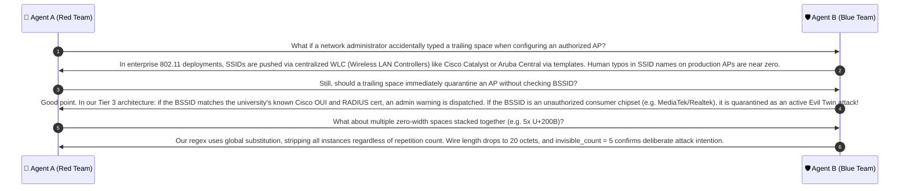

# 🔍 Case Group 2: Invisible Characters & Whitespace Manipulations

> **Case Category:** `invisible_or_whitespace`  
> **Target Whitelist AP:** `University_Campus_5G` (Length: 20 characters, 20 octets)  
> **Collaborative Agents:**
> * 🔴 **Agent A:** Offensive Wireless Security Researcher (Red Team Adversary)
> * 🛡️ **Agent B:** Defensive Wireless Security Architect (Blue Team Defender)

---

## 1. Test Case Roster & Technical Parameters

| Test Case | Injected Character | Unicode Codepoint | UTF-8 Bytes (Hex) | Char Len | Wire Byte Len | Ground Truth | Detection Mechanism |
| :--- | :---: | :---: | :---: | :---: | :---: | :---: | :--- |
| `University_Campus_5G​` | Zero-Width Space (ZWSP) | `U+200B` | `e2 80 8b` | 21 | 23 | **EVIL_TWIN** | Non-printable stripping + Anomaly Flag |
| `University_Campus_5G ` | Trailing ASCII Space | `U+0020` | `20` | 21 | 21 | **EVIL_TWIN** | Edge whitespace trimming + IOA Flag |
| `\ufeffUniversity_Campus_5G` | Byte Order Mark (BOM) | `U+FEFF` | `ef bb bf` | 21 | 23 | **EVIL_TWIN** | Leading BOM stripping + Prefix Guard |
| `University\u00a0Campus_5G` | Non-Breaking Space | `U+00A0` | `c2 a0` | 20 | 21 | **EVIL_TWIN** | Whitespace normalization (`\u00A0` $\to$ ` `) |

---

## 2. Red Team Offensive Analysis (Agent A)

### 2.1 The "Invisible Cloak" Exploit
In modern GUI desktop and mobile environments (Windows 10/11 taskbar flyout, Android Wi-Fi Picker, Apple iOS Settings):
1. **Zero-Width Codepoints (`U+200B..U+200D`, `U+FEFF`):**
   - The Unicode standard defines these characters with property `Default_Ignorable_Code_Point`.
   - Text layout engines assign them an advance width of **0 pixels** with no visible glyph or missing-character glyph (no "tofu" `□` box).
   - Placed anywhere inside or at the end of an SSID, the rendered SSID is **100% visually identical** to `University_Campus_5G`.
2. **Trailing / Leading Whitespace (`U+0020`):**
   - Wi-Fi list items in Windows and Android use standard UI `Label` / `TextBlock` controls with right-aligned or left-aligned layouts.
   - Trailing spaces are automatically clipped by label boundaries or rendered into empty margin space.
   - The user cannot see a space at the end of `University_Campus_5G `.

### 2.2 Defensive Failure Modes
- **Exact Whitelist Collision:** A hash lookup `hash("University_Campus_5G\u200b") == hash("University_Campus_5G")` evaluates to `False`. The rogue AP completely bypasses Tier 1 whitelist whitelisting!
- **Prefix Destruction via Leading BOM (`U+FEFF`):**
  - If placed at index 0 (`\ufeffUniversity_Campus_5G`), character 0 is `\ufeff`.
  - Prefix match algorithm comparing `s[0] == target[0]` fails at the first character! $f_{13}$ (Prefix Ratio) collapses from $1.0000 \to 0.0000$.
- **NFKC Blindness:** Normalization Form NFKC does **not** strip zero-width spaces or BOMs. It preserves them as valid Unicode characters.

---

## 3. Blue Team Defensive Architecture (Agent B)

### 3.1 Two-Stage Whitespace & Non-Printable Sanitizer
To defeat invisible manipulations, the pipeline executes a dedicated pre-processing filter before computing string similarity:

```python
import re

# Comprehensive regex matching zero-width, non-printing, and control codes
INVISIBLE_REGEX = re.compile(
    r'[\u200B-\u200D\uFEFF\u00AD\u200E\u200F\u202A-\u202E\u2060-\u206F\x00-\x1F\x7F-\x9F]'
)

def sanitize_invisible_and_whitespace(raw_ssid: str) -> tuple[str, dict]:
    # 1. Capture evasion Indicators of Attack (IOAs) before modification
    invisible_matches = INVISIBLE_REGEX.findall(raw_ssid)
    has_trailing_space = raw_ssid.endswith(" ")
    has_leading_space = raw_ssid.startswith(" ")
    has_nbsp = "\u00a0" in raw_ssid
    
    # 2. Strip invisible characters
    cleaned = INVISIBLE_REGEX.sub('', raw_ssid)
    
    # 3. Normalize non-breaking spaces to standard space
    cleaned = cleaned.replace('\u00a0', ' ')
    
    # 4. Strip surrounding whitespace
    cleaned = cleaned.strip()
    
    ioa_flags = {
        "invisible_count": len(invisible_matches),
        "has_trailing_space": has_trailing_space,
        "has_leading_space": has_leading_space,
        "has_nbsp": has_nbsp,
        "evasion_detected": bool(invisible_matches or has_trailing_space or has_leading_space or has_nbsp)
    }
    return cleaned, ioa_flags
```

### 3.2 The "Trap-and-Trace" Logic
Instead of silently stripping invisible characters and passing the sanitized text downstream:
1. The pipeline records an **Indicator of Attack (IOA)** flag.
2. If `cleaned_ssid in whitelist` **AND** `ioa_flags["evasion_detected"] == True`, the system **does not** mark it as benign!
3. It immediately raises a deterministic **`CONFIRMED_EVIL_TWIN`** security alert:
   > *"Evasion Detected: Rogue AP is broadcasting authorized institutional SSID with hidden zero-width or trailing whitespace padding."*

---

## 4. Collaborative Discussion & Logic Refinement



---

## 5. Production Reference Implementation

```python
import re
from typing import Dict, Any

INVISIBLE_REGEX = re.compile(
    r'[\u200B-\u200D\uFEFF\u00AD\u200E\u200F\u202A-\u202E\u2060-\u206F\x00-\x1F\x7F-\x9F]'
)

def evaluate_invisible_whitespace(raw_ssid: str, whitelist: list[str]) -> Dict[str, Any]:
    """
    Evaluates raw SSID for hidden codepoint evasions and trailing whitespace tricks.
    """
    invisible_matches = INVISIBLE_REGEX.findall(raw_ssid)
    has_trailing_space = raw_ssid.endswith(" ")
    has_leading_space = raw_ssid.startswith(" ")
    has_nbsp = "\u00a0" in raw_ssid
    
    # Strip invisible characters and normalize whitespace
    cleaned = INVISIBLE_REGEX.sub("", raw_ssid)
    cleaned = cleaned.replace("\u00a0", " ").strip()
    
    evasion_detected = bool(invisible_matches or has_trailing_space or has_leading_space or has_nbsp)
    is_evil_twin = False
    
    if cleaned in whitelist:
        if raw_ssid not in whitelist and evasion_detected:
            is_evil_twin = True
            
    return {
        "raw_ssid": raw_ssid,
        "cleaned_ssid": cleaned,
        "invisible_count": len(invisible_matches),
        "has_trailing_space": has_trailing_space,
        "has_leading_space": has_leading_space,
        "has_nbsp": has_nbsp,
        "is_evil_twin": is_evil_twin,
        "status": "EVIL_TWIN" if is_evil_twin else "NORMAL"
    }

# Unit Test Verification
if __name__ == "__main__":
    wl = ["University_Campus_5G"]
    cases = [
        "University_Campus_5G\u200b",    # Zero-width space
        "University_Campus_5G ",        # Trailing space
        "\ufeffUniversity_Campus_5G",    # Byte Order Mark
        "University\u00a0Campus_5G",    # Non-breaking space
    ]
    for c in cases:
        res = evaluate_invisible_whitespace(c, wl)
        assert res["is_evil_twin"] == True
        assert res["cleaned_ssid"] == "University_Campus_5G"
    print("✅ All Invisible & Whitespace evasion test cases verified successfully!")
```
