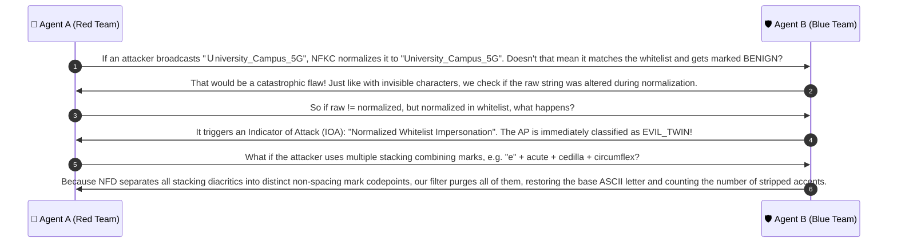

# 🔍 Case Group 3: Unicode Normalization & Combining Accents

> **Case Category:** `normalization_and_combining_accents`  
> **Target Whitelist AP:** `University_Campus_5G` (Length: 20 characters, 20 octets)  
> **Collaborative Agents:**
> * 🔴 **Agent A:** Offensive Wireless Security Researcher (Red Team Adversary)
> * 🛡️ **Agent B:** Defensive Wireless Security Architect (Blue Team Defender)

---

## 1. Test Case Roster & Technical Parameters

| Test Case | Injected Character | Unicode Codepoint | UTF-8 Bytes (Hex) | Char Len | Wire Byte Len | Ground Truth | Detection Mechanism |
| :--- | :---: | :---: | :---: | :---: | :---: | :---: | :--- |
| `Ｕniversity_Campus_5G` | Fullwidth Latin Capital `Ｕ` | `U+FF35` | `ef bc b5` | 20 | 22 | **EVIL_TWIN** | Unicode NFKC Normalization |
| `Univ\u0065\u0301rsity_Campus_5G` | Combining Acute Accent | `e` + `U+0301` | `65 cc 81` | 21 | 22 | **EVIL_TWIN** | NFD + Latin `Mn` Mark Stripping |
| `Univérsity_Campus_5G` | Precomposed Latin `é` | `U+00E9` | `c3 a9` | 20 | 21 | **EVIL_TWIN** | NFD + Latin `Mn` Mark Stripping |

---

## 2. Red Team Offensive Analysis (Agent A)

### 2.1 Fullwidth Evasion Mechanics
- In East Asian multi-byte character encodings (Shift-JIS, GBK, Big5), ASCII letters were mapped into the **Halfwidth and Fullwidth Forms** Unicode block (`U+FF00..U+FFEF`).
- Fullwidth Latin Capital Letter `Ｕ` (`U+FF35`, UTF-8: `\xef\xbc\xb5`) is rendered by standard fonts with double-width spacing: `Ｕniversity_Campus_5G`.
- **Evasion Impact:** In raw byte comparison, `0xEF 0xBC 0xB5 != 0x55`. The initial prefix byte match fails instantly, dropping $f_{13}$ (Prefix Ratio) to **$0.0000$**!

### 2.2 Combining Diacritics Deconstruction
- In Unicode, an accented glyph can be represented in two fundamentally different forms:
  1. **Precomposed Form (NFC):** `é` (`U+00E9`, 1 character, 2 bytes).
  2. **Decomposed Form (NFD):** `e` (`U+0065`) followed by `U+0301` (Combining Acute Accent, 2 characters, 3 bytes).
- At the pixel level, both render identically as `é`.
- **Why NFKC Fails on Accents:** Normalization Form NFKC composes decomposed characters into precomposed NFC (`e` + `\u0301` $\to$ `é`). However, **it does not strip the accent**! `é` remains `\u00e9` and does not equal plain ASCII `e` (`\u0065`).
- An attacker adding a faint dot, tilde, or accent over a letter can evade whitelist matching while the human eye overlooks the minor mark on small mobile displays.

---

## 3. Blue Team Defensive Architecture (Agent B)

### 3.1 Normalization Forms Comparison Matrix

| Target Character / Sequence | Raw Bytes | NFC | NFD | NFKC | NFKD | Stripped Latin NFD |
| :--- | :---: | :---: | :---: | :---: | :---: | :---: |
| **Fullwidth `Ｕ` (`U+FF35`)** | `ef bc b5` | `Ｕ` (`U+FF35`) | `Ｕ` (`U+FF35`) | **`U` (`U+0055`)** | **`U` (`U+0055`)** | **`U`** ✅ |
| **Decomposed `e` + ` ́` (`U+0065 U+0301`)** | `65 cc 81` | `é` (`U+00E9`) | `e` + ` ́` | `é` (`U+00E9`) | `e` + ` ́` | **`e`** ✅ |
| **Precomposed `é` (`U+00E9`)** | `c3 a9` | `é` (`U+00E9`) | `e` + ` ́` | `é` (`U+00E9`) | `e` + ` ́` | **`e`** ✅ |

### 3.2 The Two-Step Normalization & Diacritic Stripping Logic
1. **Step 1 (NFKC Compatibility Fold):**
   `s_nfkc = unicodedata.normalize('NFKC', s)`  
   Folds fullwidth characters (`Ｕ` $\to$ `U`), ligatures (`fi` $\to$ `fi`), superscripts, and circled numbers into canonical ASCII equivalents.
2. **Step 2 (Selective Diacritic Removal via NFD):**
   Decompose the string into base letters and non-spacing marks (`Mn`):
   `s_nfd = unicodedata.normalize('NFD', s_nfkc)`

### 3.3 ⚠️ The Non-Latin Diacritic Trap & Fix
- **CRITICAL VULNERABILITY:** If a defender naively strips all characters in category `Mn` (`unicodedata.category(c) == 'Mn'`), it destroys legitimate non-Latin languages!
- In **Thai** (`บ้านสุข`), the tone mark `่` (`U+0E49`) and upper vowel `ิ` (`U+0E34`) are categorized as `Mn`. Stripping all `Mn` corrupts `บ้านสุข` into `บานสข`.
- **The Solution:** We restrict diacritic stripping **only to the Latin range** (`c <= \u024F` or Combining Diacritical Marks block `\u0300-\u036F` attached to Latin bases), leaving non-Latin languages untouched!

---

## 4. Collaborative Discussion & Logic Refinement



---

## 5. Production Reference Implementation

```python
import unicodedata
from typing import Dict, Any

def normalize_and_strip_latin_accents(s: str) -> tuple[str, int]:
    """
    1. Normalizes fullwidth characters via NFKC.
    2. Selectively strips combining diacritics from Latin characters.
    Preserves non-Latin scripts (Thai, Arabic, Hebrew).
    """
    # Step 1: NFKC Compatibility Normalization
    nfkc_str = unicodedata.normalize("NFKC", s)
    
    # Step 2: NFD Decomposition for selective diacritic stripping
    nfd_str = unicodedata.normalize("NFD", nfkc_str)
    
    accents_stripped = 0
    cleaned_chars = []
    
    for ch in nfd_str:
        # Check if character is a Combining Diacritical Mark (U+0300 - U+036F)
        if 0x0300 <= ord(ch) <= 0x036F:
            accents_stripped += 1
            continue
        # Also check general Non-Spacing Mark category for Latin characters
        if unicodedata.category(ch) == "Mn" and ord(ch) <= 0x024F:
            accents_stripped += 1
            continue
        cleaned_chars.append(ch)
        
    final_str = "".join(cleaned_chars)
    return final_str, accents_stripped

def evaluate_normalization_evasion(raw_ssid: str, whitelist: list[str]) -> Dict[str, Any]:
    cleaned, accents_count = normalize_and_strip_latin_accents(raw_ssid)
    
    is_modified = (raw_ssid != cleaned)
    is_evil_twin = False
    
    if cleaned in whitelist:
        if raw_ssid not in whitelist and is_modified:
            is_evil_twin = True
            
    return {
        "raw_ssid": raw_ssid,
        "cleaned_ssid": cleaned,
        "accents_stripped": accents_count,
        "is_modified": is_modified,
        "is_evil_twin": is_evil_twin,
        "status": "EVIL_TWIN" if is_evil_twin else "NORMAL"
    }

# Unit Test Verification
if __name__ == "__main__":
    wl = ["University_Campus_5G"]
    cases = [
        "\uff35niversity_Campus_5G",              # Fullwidth U
        "Univ\u0065\u0301rsity_Campus_5G",        # e + combining acute
        "Univ\u00e9rsity_Campus_5G",              # Precomposed é
    ]
    for c in cases:
        res = evaluate_normalization_evasion(c, wl)
        assert res["is_evil_twin"] == True
        assert res["cleaned_ssid"] == "University_Campus_5G"
        
    # Verify non-Latin preservation (Thai: บ้านสุข)
    thai_sample = "บ้านสุข"
    thai_cleaned, thai_accents = normalize_and_strip_latin_accents(thai_sample)
    assert thai_cleaned == thai_sample, f"Thai was corrupted: {thai_cleaned} != {thai_sample}"
    assert thai_accents == 0
    print("✅ All Unicode Normalization and Accent evasion tests passed!")
```
