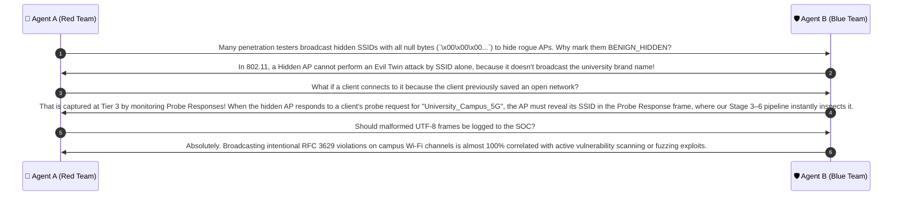

# 🔍 Case Group 5: Byte-Level Breakage & IEEE 802.11 Boundary Conditions

> **Case Category:** `byte_level_breakage`  
> **Standard References:** IEEE Std 802.11™-2020 (Clause 9.4.2.2), IETF RFC 3629 (UTF-8 Standard)  
> **Collaborative Agents:**
> * 🔴 **Agent A:** Offensive Wireless Security Researcher (Red Team Adversary)
> * 🛡️ **Agent B:** Defensive Wireless Security Architect (Blue Team Defender)

---

## 1. Test Case Roster & Technical Parameters

| Test Case | Wire Byte Payload (Hex) | Byte Len | Expected Standard Behavior | Vulnerability Target | Classification |
| :--- | :--- | :---: | :--- | :--- | :---: |
| **`33 × A`** | `41 41 41 ... 41` (33 bytes) | 33 | Exceeds IEEE 802.11 32-octet limit | Buffer Overflow in C/C++ firmware | **`INVALID_FRAME`** |
| **`c1 a1`** | `c1 a1` (2 bytes) | 2 | Illegal Overlong UTF-8 Encoding for `'a'` | Parser Confusion / WAF Filter Bypass | **`MALFORMED_UTF8`** |
| **`30 × A + \xe0\xb8`**| `41 ... 41 e0 b8` (32 bytes) | 32 | Truncated 3-byte sequence (missing 3rd byte of `'ก'`) | State Machine Crash / Memory Over-read | **`MALFORMED_UTF8`** |
| **`Empty SSID`** | `""` (0 octets) | 0 | Legal IEEE 802.11 Hidden AP / Wildcard Probe | Division-by-Zero in Length Ratio ($f_8$) | **`BENIGN_HIDDEN`** |

---

## 2. Red Team Offensive Analysis (Agent A)

### 2.1 The Threat of IEEE 802.11 Buffer Corruptions
- Under IEEE 802.11 standards, Information Element 0 (SSID Element) has a length field of 1 octet. However, the standard explicitly restricts valid length to $[0, 32]$ octets.
- **Buffer Overflow (Case 5.1):** Many low-level C network drivers and embedded sensor firmwares allocate a fixed stack array `char ssid[32];` or `char ssid[33];`. If a rogue AP injects a beacon frame declaring length 33 or 255:
  - Without bounds checks, writing to the buffer corrupts the stack frame or causes an immediate Segmentation Fault (`SIGSEGV`).
  - An attacker broadcasts this malformed frame specifically to **blind the edge detector** (Denial of Service).

### 2.2 Exploiting Overlong UTF-8 Encodings (Case 5.2)
- In UTF-8, ASCII characters ($0x00 - 0x7F$) must strictly be encoded in a single byte.
- An attacker can encode ASCII `'a'` (`0x61`) as a 2-byte sequence using lead byte `0xC1`:
  $$0xC1 \quad 0xA1 \implies (11000001_2 \quad 10100001_2) \implies 00001 \cdot 2^6 + 100001_2 = 0x61 \text{ ('a')}$$
- **RFC 3629 Violation:** In 2003, RFC 3629 outlawed all overlong encodings because attackers used `0xC0 0xAF` to bypass directory traversal filters (`/`).
- If an edge sensor relies on non-conforming C decoders, `0xC1 0xA1` is decoded to `'a'`, while if it relies on strict Python `bytes.decode('utf-8')`, an unhandled `UnicodeDecodeError` crashes the entire daemon thread!

### 2.3 Truncated Multi-Byte Sequences (Case 5.3)
- An attacker broadcasts 30 ASCII `'A'` characters followed by `0xE0 0xB8` (the first two bytes of Thai consonant `'ก'`). Total wire length is exactly 32 octets (legal 802.11 length).
- However, byte `0xE0` signals a 3-byte sequence. The 3rd byte is missing.
- In naive C loops relying on `mbstowcs()`, this returns `-1`, which if cast to an `unsigned int` causes a 4GB memory copy loop.

### 2.4 The Zero-Length Hidden AP Trap (Case 5.4)
- When an SSID length is 0 (or contains only `0x00`), naive feature extractors compute:
  $$f_8 = \frac{\min(\text{len}(s_1), \text{len}(s_2))}{\max(\text{len}(s_1), \text{len}(s_2))} \implies \frac{0}{0} \implies \text{ZeroDivisionError}$$
- Or in Levenshtein calculations, accessing `s[0]` triggers `IndexError: string index out of range`.

---

## 3. Blue Team Defensive Architecture (Agent B)

### 3.1 Strict 3-Stage Byte Ingestion Gateway
Before any string or machine learning algorithm touches the incoming 802.11 packet, it must pass through an impermeable byte validation gateway:

```
[Incoming 802.11 Packet]
         │
         ▼
[Stage 0: Wire Length Check] ──> If len > 32 ──────────> REJECT: INVALID_FRAME
         │
         ▼
[Stage 1: Hidden SSID Check] ──> If len == 0 or 0x00* ──> ACCEPT: BENIGN_HIDDEN
         │
         ▼
[Stage 2: Strict UTF-8 Check] ─> If UnicodeDecodeError ─> REJECT: MALFORMED_PAYLOAD
         │
         ▼
[Safe UTF-8 String Passed to ML Pipeline]
```

### 3.2 Defensive Implementation Specifications
1. **Octet Bounds Enforcement:** Reject any frame where `len(raw_bytes) > 32`.
2. **Hidden Network Handling:** If `len(raw_bytes) == 0` or all bytes are null (`0x00`), mark as `BENIGN_HIDDEN` and skip text-based ML.
3. **Strict RFC 3629 Decoding:** Use `raw_bytes.decode('utf-8', errors='strict')` wrapped inside a `try-except UnicodeDecodeError` block.
   - If overlong or truncated: Quarantined gracefully without crashing the sensor.

---

## 4. Collaborative Discussion & Logic Refinement



---

## 5. Production Reference Implementation

```python
from typing import Dict, Any, Tuple

def validate_and_decode_ssid_bytes(raw_bytes: bytes) -> Tuple[str, Dict[str, Any]]:
    """
    Validates raw IEEE 802.11 SSID octets against 802.11 standards and RFC 3629 UTF-8.
    Returns: (safe_decoded_string, validation_metadata)
    """
    byte_len = len(raw_bytes)
    
    # Stage 0: 802.11 Length Boundary Check
    if byte_len > 32:
        return "", {
            "status": "INVALID_FRAME",
            "reason": f"SSID octet length {byte_len} exceeds IEEE 802.11 limit of 32 octets",
            "byte_len": byte_len,
            "is_valid": False
        }
        
    # Stage 1: Hidden SSID Check
    if byte_len == 0 or all(b == 0 for b in raw_bytes):
        return "", {
            "status": "BENIGN_HIDDEN",
            "reason": "802.11 Hidden Network / Wildcard Probe SSID",
            "byte_len": byte_len,
            "is_valid": True
        }
        
    # Stage 2: Strict RFC 3629 UTF-8 Decoding
    try:
        decoded_str = raw_bytes.decode("utf-8", errors="strict")
        return decoded_str, {
            "status": "VALID_SSID",
            "reason": "Conforming UTF-8 SSID",
            "byte_len": byte_len,
            "is_valid": True
        }
    except UnicodeDecodeError as err:
        return "", {
            "status": "MALFORMED_UTF8",
            "reason": f"RFC 3629 violation (overlong or truncated UTF-8): {str(err)}",
            "byte_len": byte_len,
            "is_valid": False
        }

# Unit Test Verification
if __name__ == "__main__":
    test_cases = [
        (b"A" * 33, "INVALID_FRAME"),
        (b"\xc1\xa1", "MALFORMED_UTF8"),
        (b"A" * 30 + b"\xe0\xb8", "MALFORMED_UTF8"),
        (b"", "BENIGN_HIDDEN"),
        (b"\x00" * 16, "BENIGN_HIDDEN"),
        (b"University_Campus_5G", "VALID_SSID")
    ]
    
    for raw, expected_status in test_cases:
        _, meta = validate_and_decode_ssid_bytes(raw)
        assert meta["status"] == expected_status, f"Expected {expected_status}, got {meta['status']}"
        
    print("✅ All Byte-Level Breakage and 802.11 Boundary tests passed successfully!")
```
