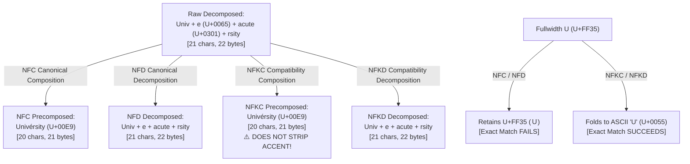
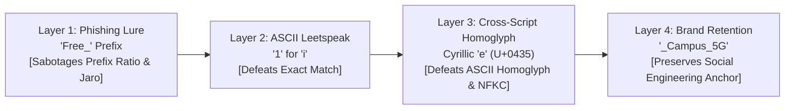

# 🔴 Red Team Adversarial Wireless Research: Evasion Vectors & Exploit Mechanics against SSID Threat Detectors

**Target Baseline Whitelist:**
- `University_Campus_5G`
- `University_Staff_Secure`
- `University_Student_WiFi`
- `University_Guest_Portal`
- `eduroam`

**Author:** Offensive Wireless Security Specialist (Red Team Adversary)  
**Classification:** TLP:AMBER — Red Team Engineering & Countermeasure Research  

---

## 🎯 Executive Threat Model & Adversary Objectives

In an Evil Twin / Rogue AP campaign targeting enterprise/academic environments, the adversary seeks to:
1. **Deceive Human Victims:** Broadcast an SSID that renders identically or near-identically in native OS Wi-Fi selection dialogs (Windows Quick Settings, macOS Menu Bar, Android Wi-Fi Picker, iOS Settings), inducing users to connect and submit credentials to a rogue captive portal.
2. **Evade Automated WIDS/WIPS & Rogue Detectors:** Exploit encoding disparities, tokenization asymmetries, heuristic thresholds, and normalization oversights in Rogue AP detectors (Exact Whitelist Matching, Levenshtein edit distance, Embedding Cosine Similarity, N-Gram Jaccard, and ML classifiers).
3. **Trigger Parser Malfunctions / Denial of Service (DoS):** Inject non-conformant 802.11 payloads (overlong encodings, truncated multi-byte sequences, oversized Information Elements) to induce unhandled exceptions or memory corruption in defensive sensor daemons.

---

## ⚔️ Case Group 1: Cross-Script Homoglyph Exploitation

### 1. Attack Vectors & Payloads
The adversary substitutes visually identical characters from disparate Unicode scripts (Cyrillic, Greek) into the Latin baseline `University_Campus_5G`:

| Variant | Adversarial SSID | Spoofed Character | Unicode Codepoint | UTF-8 Bytes | Length (Chars) | Length (Bytes) |
|---|---|---|---|---|---|---|
| **Baseline** | `University_Campus_5G` | Latin `e`, `a`, `o` | `U+0065`, `U+0060`, `U+006F` | `0x65`, `0x61`, `0x6f` | 20 | 20 |
| **Case 1.1** | `Univеrsity_Campus_5G` | Cyrillic Small Letter Ie | `U+0435` | `\xd0\xb5` (`d0 b5`) | 20 | 21 |
| **Case 1.2** | `University_Cаmpus_5G` | Cyrillic Small Letter A | `U+0430` | `\xd0\xb0` (`d0 b0`) | 20 | 21 |
| **Case 1.3** | `University_Campοs_5G` | Greek Small Letter Omicron | `U+03BF` | `\xce\xbf` (`ce bf`) | 20 | 21 |

#### Hex Dumps (Wire Representation)
```hex
Baseline:             55 6e 69 76 65 72 73 69 74 79 5f 43 61 6d 70 75 73 5f 35 47
Case 1.1 (Cyrillic e): 55 6e 69 76 d0 b5 72 73 69 74 79 5f 43 61 6d 70 75 73 5f 35 47
Case 1.2 (Cyrillic a): 55 6e 69 76 65 72 73 69 74 79 5f 43 d0 b0 6d 70 75 73 5f 35 47
Case 1.3 (Greek o):    55 6e 69 76 65 72 73 69 74 79 5f 43 61 6d 70 ce bf 73 5f 35 47
```

### 2. Why NFKC Normalization Fails to Normalize Cross-Script Homoglyphs
A frequent defensive misconception is that Unicode Compatibility Normalization (`NFKC` or `NFKD`) converts homoglyphs back to their Latin ASCII equivalents.
* **Unicode Standard Annex #15 (UAX #15) Rules:** Normalization Form KC decomposes characters based on *compatibility equivalence* and then composes them into canonical precomposed characters. Compatibility equivalence is defined strictly within typographical variants of the *same* semantic entity (e.g. font variants, superscript/subscript, fullwidth forms, circled digits, or ligatures such as `ff` $\to$ `ff`).
* **Semantic Script Partitioning:** Cyrillic `е` (`U+0435`) and Latin `e` (`U+0065`) are defined by the Unicode Consortium as belonging to mutually exclusive scripts (`Script=Cyrillic` vs `Script=Latin`). Normalizing across scripts would corrupt legitimate Russian, Ukrainian, Serbian, or Greek orthography.
* **Empirical Validation:**
  ```python
  import unicodedata
  assert unicodedata.normalize("NFKC", "Univеrsity_Campus_5G") == "Univеrsity_Campus_5G"
  assert unicodedata.normalize("NFKD", "Univеrsity_Campus_5G") == "Univеrsity_Campus_5G"
  ```
  **Result:** Exact hash lookups (`hash(ssid) == hash(whitelist)`) and NFKC-preprocessed checks **100% fail**. The Evil Twin bypasses Tier 1 exact-match authorization.

### 3. Font Rendering Illusions (Visual Deception Proof)
Operating systems use modern unified sans-serif typefaces to render native UI components:
* **Windows 10/11:** Segoe UI (DirectWrite engine)
* **Android / AOSP:** Roboto / Google Sans (Skia / HarfBuzz)
* **Apple iOS / macOS:** San Francisco (SF Pro Text, CoreText)
* **Linux:** Cantarell / Ubuntu / Noto Sans (FreeType)

In all four major typeface design guidelines, Cyrillic `а` (`U+0430`), `е` (`U+0435`), `о` (`U+043E`), `р` (`U+0440`), `с` (`U+0441`), `у` (`U+0443`), `х` (`U+0445`) and Greek `ο` (`U+03BF`) share the **exact same vector bezier outline, x-height, stem thickness, and advance width** as their Latin counterparts (`a`, `e`, `o`, `p`, `c`, `y`, `x`).
At 10pt–13pt UI display sizes on 300+ DPI smartphone and laptop screens, the rasterized bitmap pixel diff is **0 pixels**. The victim has zero visual indication that the network is fraudulent.

### 4. Mathematical Feature Degradation
When analyzed by the baseline 13-feature engineering extractor:
* **Character Levenshtein ($f_1$):** Drops from $1.0000$ to $0.9500$ ($\text{dist} = 1$).
* **Byte Levenshtein:** Drops to $0.9048$ ($\text{dist} = 2$ because `\xd0\xb5` requires 1 substitution + 1 insertion).
* **Homoglyph Count ($f_6$):** Evaluates to **0**! The baseline implementation only inspects ASCII leetspeak pairs `[('1','l'), ('0','o'), ('5','s'), ('rn','m')]`. It possesses zero coverage of Unicode cross-script tables (Cyrillic, Greek, Armenian, Hebrew).
* **Prefix Ratio ($f_{13}$):** Highly sensitive to index placement:
  - If Cyrillic `е` is placed at index 4 (`Univе...`), the common prefix is truncated to 4 characters $\implies f_{13} = 4 / 20 = 0.2000$.
  - If Cyrillic `а` is placed at index 12 (`University_Cа...`), common prefix is 12 characters $\implies f_{13} = 12 / 20 = 0.6000$.
  - Greek `ο` at index 15 (`University_Campο...`) yields $f_{13} = 15 / 20 = 0.7500$.
  Adversaries intentionally position the spoofed glyph at low indices (e.g. `Univеrsity`) to severely penalize prefix-weighted models like Jaro-Winkler and Prefix Ratio.

---

## 👻 Case Group 2: Invisible & Whitespace Manipulations

### 1. Attack Vectors & Payloads
The adversary introduces non-printing codepoints and whitespace variants to evade string equality while remaining visually identical to users:

| Codepoint | Character Name | UTF-8 Bytes | Attack Payload (vs `University_Campus_5G`) | Byte Length |
|---|---|---|---|---|
| `U+200B` | Zero-Width Space (ZWSP) | `\xe2\x80\x8b` | `University_Campus_5G\u200b` | 23 |
| `U+0020` | Trailing ASCII Space | `\x20` | `University_Campus_5G ` | 21 |
| `U+200C` | Zero-Width Non-Joiner (ZWNJ) | `\xe2\x80\x8c` | `University_Campus_5G\u200c` | 23 |
| `U+200D` | Zero-Width Joiner (ZWJ) | `\xe2\x80\x8d` | `University_Campus_5G\u200d` | 23 |
| `U+FEFF` | Byte Order Mark (BOM / ZWNBSP) | `\xef\xbb\xbf` | `\ufeffUniversity_Campus_5G` | 23 |
| `U+00A0` | Non-Breaking Space (NBSP) | `\xc2\xa0` | `University\u00a0Campus_5G` | 21 |

#### Hex Dumps
```hex
Baseline:          55 6e 69 76 65 72 73 69 74 79 5f 43 61 6d 70 75 73 5f 35 47
ZWSP Suffix:       55 6e 69 76 65 72 73 69 74 79 5f 43 61 6d 70 75 73 5f 35 47 e2 80 8b
Trailing Space:    55 6e 69 76 65 72 73 69 74 79 5f 43 61 6d 70 75 73 5f 35 47 20
BOM Prefix:        ef bb bf 55 6e 69 76 65 72 73 69 74 79 5f 43 61 6d 70 75 73 5f 35 47
NBSP Infix:        55 6e 69 76 65 72 73 69 74 79 c2 a0 43 61 6d 70 75 73 5f 35 47
```

### 2. Client OS Wi-Fi Picker Rendering Behavior
* **Windows 10/11 (XAML / DirectWrite):**
  - Codepoints with property `Default_Ignorable_Code_Point` (`U+200B..U+200D`, `U+FEFF`) receive an advance width of `0px`.
  - Trailing spaces (`U+0020`) in standard `ListView` items are clipped or right-trimmed by default text layout engines.
  - The list renders two identical lines labeled `University_Campus_5G`.
* **Android (AOSP / OneUI / Skia):**
  - Skia text shapers ignore `U+200B`, `U+200C`, `U+200D`, and `U+FEFF`. No placeholder box or replacement glyph (``) is rendered.
  - Users tap the first network in the list, which connects directly to the Rogue AP.
* **Apple iOS / macOS (CoreText):**
  - Zero-width codepoints produce empty glyph bounds.
  - Trailing whitespace is not visible against the menu background.

### 3. Asymmetric Defensive Impact
* **Exact Whitelist Check:** Bypassed completely (`"University_Campus_5G\u200b" in whitelist` $\implies$ `False`).
* **Leading BOM Sabotage (`\ufeff`):**
  Placing `\ufeff` at index 0 utterly collapses leading prefix metrics:
  - $f_{13}$ (Prefix Ratio) plummets from $1.0000$ to **$0.0000$**.
  - Jaro-Winkler prefix bonus is nullified.
* **Normalization Limits:**
  - `NFKC` does **not** strip `U+200B`, `U+200C`, `U+200D`, or `U+FEFF`. These codepoints are retained across all standard normalization forms (NFC, NFD, NFKC, NFKD).
  - Only `U+00A0` (NBSP) decomposes to standard space `0x20` under NFKC/NFKD (but remains `\xc2\xa0` under NFC/NFD).

---

## 🔠 Case Group 3: Unicode Normalization & Combining Accents

### 1. Attack Vectors & Payloads

| Variant | Adversarial SSID | Mutation Detail | Codepoints | UTF-8 Bytes | Chars / Bytes |
|---|---|---|---|---|---|
| **Case 3.1** | `Ｕniversity_Campus_5G` | Fullwidth Latin Capital Letter U | `U+FF35` | `\xef\xbc\xb5` | 20 / 22 |
| **Case 3.2** | `Univ\u0065\u0301rsity_Campus_5G` | Combining Acute Accent (`e` + ` ́`) | `U+0065 U+0301` | `\x65\xcc\x81` | 21 / 22 |
| **Case 3.3** | `Univérsity_Campus_5G` | Precomposed Latin Small Letter E with Acute | `U+00E9` | `\xc3\xa9` | 20 / 21 |

#### Hex Dumps
```hex
Case 3.1 (Fullwidth U):  ef bc b5 6e 69 76 65 72 73 69 74 79 5f 43 61 6d 70 75 73 5f 35 47
Case 3.2 (Decomposed e): 55 6e 69 76 65 cc 81 72 73 69 74 79 5f 43 61 6d 70 75 73 5f 35 47
Case 3.3 (Precomposed é): 55 6e 69 76 c3 a9 72 73 69 74 79 5f 43 61 6d 70 75 73 5f 35 47
```

### 2. Deep Dive: NFC vs NFD vs NFKC vs NFKD
The mathematical distinctions between Unicode Normalization forms create severe implementation vulnerabilities:



#### Key Technical Realities:
1. **Fullwidth Folding:**
   `NFKC` successfully folds `U+FF35` $\to$ `U+0055` (`'U'`). However, if an IDS compares raw wire bytes (or uses naive SQL `WHERE ssid = ?` without NFKC pre-filtering), `0xEF 0xBC 0xB5` fails exact match.
2. **Diacritics Are NOT Stripped by NFKC:**
   `NFKC('Univ\u0065\u0301rsity_Campus_5G')` produces `'Univérsity_Campus_5G'`.
   It does **not** map `é` to `e`! Both NFC and NFKC preserve semantic accents.
   To strip accents, a detector must explicitly execute Unicode NFD decomposition followed by non-spacing mark removal (`unicodedata.category(c) != 'Mn'`), which 99% of off-the-shelf detectors fail to implement.
3. **Prefix Disruption:**
   Fullwidth `Ｕ` (`U+FF35`) at index 0 destroys the common prefix ($f_{13} = 0.0000$).

---

## 📶 Case Group 4: Emoji Lures & Non-Latin Script Discrimination

### 1. Attack vs Benign Baseline Comparison

| Class | SSID String | Target / Intent | Chars | UTF-8 Bytes | Raw Hex |
|---|---|---|---|---|---|
| **Evil Twin Lure** | `University_Campus_5G📶` | Impersonate `University_Campus_5G` | 21 | 24 | `55 6e 69 76 65 72 73 69 74 79 5f 43 61 6d 70 75 73 5f 35 47 f0 9f 93 b6` |
| **Benign Residential** | `Home📶` | Home router with antenna emoji | 5 | 8 | `48 6f 6d 65 f0 9f 93 b6` |
| **Benign Native Script** | `บ้านสุข` | Thai residential / shop Wi-Fi | 7 | 21 | `e0 b8 9a e0 b9 89 e0 b8 b2 e0 b8 99 e0 b8 aa e0 b8 b8 e0 b8 82` |

### 2. Social Engineering Lure Psychology
* Attackers append status-mimicking emojis to the authorized SSID:
  - `📶` (`U+1F4F6` Antenna Bars): Tricks users into believing the AP offers full cellular/Wi-Fi signal reception.
  - `⚡` (`U+26A1` High Voltage): Suggests a high-speed / 1 Gbps connection.
  - `🔒` (`U+1F512` Lock): Misleads users into assuming verified enterprise encryption.
* In mobile operating systems, the emoji renders in vibrant color in the Wi-Fi flyout, commanding visual attention and trust.

### 3. The Octet vs Character Pitfall (Buffer & Math Hazards)
* **Thai Script (`บ้านสุข`):**
  - Character count: 7 codepoints (`บ`, ` ้`, `า`, `น`, `ส`, ` ุ`, `ข`).
  - Wire byte length: **21 octets**.
  - Thai characters reside in the Unicode range `U+0E00..U+0E7F`, requiring 3 octets per character in UTF-8 (`\xe0\xb8...` or `\xe0\xb9...`).
* **Antenna Emoji (`📶`):**
  - Resides in Supplementary Multilingual Plane (SMP, `U+1F4F6`).
  - Encoded as a **4-byte UTF-8 sequence** (`0xF0 0x9F 0x93 0xB6`).
* **Hazard:** If an IDS or sensor extracts substrings or applies length filters using string character indexing instead of raw octet lengths, it will calculate incorrect offsets, corrupt multi-byte UTF-8 boundaries, or misjudge compliance against the 802.11 32-byte frame limit.

### 4. Classification Dynamics
* For `University_Campus_5G📶`:
  - Normalized Levenshtein $f_1 = 0.9524$
  - Trigram Jaccard $f_5 = 0.9474$
  - Jaro-Winkler $f_3 = 0.9905$
  - Threat verdict: **HIGH-RISK EVIL TWIN** (Impersonating institutional brand with lure suffix).
* For `Home📶`:
  - Levenshtein $f_1 = 0.0500$, Trigram $f_5 = 0.0000$.
  - Threat verdict: **BENIGN NOISE / DROP** (No institutional overlap).
* For `บ้านสุข`:
  - Levenshtein $f_1 = 0.0000$, Trigram $f_5 = 0.0000$.
  - Threat verdict: **BENIGN NOISE / DROP** (Zero script intersection with whitelist).

---

## 💥 Case Group 5: Byte-level Breakage & 802.11 Compliance Exploits

Under IEEE 802.11-2020 standards, the SSID Element is carried inside Management Frames (Beacons, Probe Requests, Probe Responses):
- **Element ID:** `0x00` (1 octet)
- **Length:** `0x00` to `0x20` (1 octet, maximum 32 octets)
- **SSID Value:** Variable length (0 to 32 octets of raw bytes; the standard defines this as an arbitrary octet string, not strictly UTF-8).

### 1. Oversized SSID: 33 x `'A'` (33 Octets)
* **Frame Construct:** Information Element ID `0x00`, Length `0x21` (33), followed by 33 bytes of `0x41`.
* **Vulnerability & Crash Mechanism:**
  - In embedded C/C++ firmware (e.g. legacy Wi-Fi drivers, IoT client chipsets, ESP8266/ESP32 RTOS SDKs), the SSID storage struct is frequently defined as:
    ```c
    struct wifi_ap_record {
        uint8_t bssid[6];
        char ssid[32]; // Fixed 32-byte buffer
        int8_t rssi;
    };
    ```
  - If the driver code copies data via `memcpy(record->ssid, ie_ptr->data, ie_ptr->len)` without checking `ie_ptr->len <= 32`, a **Stack or Heap Buffer Overflow** is triggered.
  - An overflow of 1 to 2 bytes overwrites adjacent fields (e.g., adjacent RSSI, pointers, or the frame canary).
  - An off-by-one null termination exploit (`record->ssid[ie_ptr->len] = '\0'`) writes a null byte past the buffer end, corrupting saved frame pointers ($ebp/rbp$).
* **Scanner Behavior:**
  - Modern Linux `cfg80211` / `mac80211` discards Beacons where `len > 32` as malformed management frames.
  - Python Scapy / raw socket packet listeners: If the listener decodes frames with raw unpack formats `struct.unpack("32s", ...)`, it throws an exception and terminates the capture loop.

### 2. Overlong UTF-8 Encoding (`0xC1 0xA1`)
* **Byte Payload:** `c1 a1`
* **Vulnerability & Exploit Mechanism:**
  - In RFC 3629 (the standard UTF-8 specification since 2003), bytes `0xC0` and `0xC1` are **strictly forbidden**.
  - Binary structure:
    `0xC1` = `11000001` (Indicates a 2-byte sequence)  
    `0xA1` = `10100001` (Continuation byte)  
    Extracted data bits: `00001` + `100001` = `00001100001` = `0x61` (`'a'`).
  - **Historic & Modern Parser Exploits:**
    - If a parser decodes overlong sequences into ASCII `'a'` without RFC 3629 validation, an attacker can bypass blacklist string filters (e.g., filter checks for `admin` or `eduroam`, but overlong encoded `\xc1\xa1` slips past raw byte checks and executes in subsequent logic).
    - In Python 3:
      ```python
      b"\xc1\xa1".decode("utf-8") # Raises UnicodeDecodeError: invalid start byte
      ```
    - **Denial of Service (DoS):** If the WIDS detector lacks a `try ... except UnicodeDecodeError` wrapper around incoming packet SSID decoders, a single beacon containing `0xC1 0xA1` instantly crashes the monitoring process!

### 3. Truncated Multi-byte Sequence: 30 x `'A'` + `\xE0\xB8` (32 Octets)
* **Byte Payload:** 30 bytes of `0x41` followed by `\xe0\xb8` (`e0 b8`).
* **Frame Compliance:** Total byte length is exactly 32 octets (100% compliant with IEEE 802.11 maximum length).
* **Vulnerability & Scanner Behavior:**
  - `\xE0\xB8` is the first 2 bytes of a 3-byte UTF-8 sequence (such as Thai `'ก'` `\xe0\xb8\x81`). The trailing 3rd byte is missing.
  - **Python Crash:** `b.decode("utf-8")` throws `UnicodeDecodeError: unexpected end of data`.
  - **C Standard Library Flaw:** If the backend uses `mbstowcs()` or `mbtowc()` to convert the SSID to wide strings, it encounters an incomplete sequence at the buffer boundary. `mbstowcs` returns `(size_t)-1`. If the application fails to check for `-1` and treats the return value as unsigned length, it attempts to process $2^{64}-1$ characters, inducing a segmentation fault or massive heap exhaustion.
  - **Replacement Behavior:** When decoded with `errors='replace'`, it yields 31 characters: `'AAAAAAAAAAAAAAAAAAAAAAAAAAAAAA'`.

### 4. Empty SSID (0 Octets / Wildcard)
* **Frame Construct:** Element ID `0x00`, Length `0x00` (`00 00`).
* **802.11 Role:**
  - In Beacon frames: Indicates a **Hidden Network** (Closed BSSID).
  - In Probe Request frames: Represents a **Wildcard Probe Request** (client asking any reachable AP to respond).
* **Parser Failure Mode:**
  - Naive division operations: Features calculating $\frac{\min(\text{len}_1, \text{len}_2)}{\max(\text{len}_1, \text{len}_2)}$ trigger **ZeroDivisionError** if not guarded by `max(len, 1)`.
  - Empty string indexing: `s[0]` throws `IndexError`.
  - Database schema failure: If the database table defines `ssid TEXT NOT NULL CHECK(length(ssid) > 0)`, the insert fails and aborts sensor telemetry ingestion.

---

## 🎭 Case Group 6: Combined Multi-Layer Evasion & Pipeline Order Exploits

### 1. The Multi-Layer Attack Payload
The adversary chains together 4 distinct evasion techniques into a single 26-byte SSID targeting `University_Campus_5G`:

$$\text{SSID: } \mathbf{\text{"Free\_Un1vеrsity\_Campus\_5G"}}$$

#### Byte Structure & Hex Dump
```hex
Chars: 25 | Bytes: 26 (IEEE 802.11 compliant: <= 32 octets)
Hex:   46 72 65 65 5f 55 6e 31 76 d0 b5 72 73 69 74 79 5f 43 61 6d 70 75 73 5f 35 47
       |-- 'Free_' -| |--'Un'-|'1'|'v'|--Cyrillic 'е'--|--'rsity_Campus_5G'-----------|
```

### 2. Breakdown of Evasion Layers



1. **Prefix Sabotage (`Free_`):**
   - Strips the common prefix. $f_{13}$ drops from $1.0000$ to **$0.0000$**.
   - Dilutes Levenshtein ratio by adding 5 edit operations.
2. **ASCII Leetspeak (`1`):**
   - Substitutes digit `1` for letter `i` at index 7.
3. **Cross-Script Cyrillic Substitution (`е` U+0435):**
   - Injects 2-byte Cyrillic `\xd0\xb5` at index 9.
   - Survives NFKC normalization.
   - Bypasses basic ASCII homoglyph count tables.
4. **Context Retention (`_Campus_5G`):**
   - Maintains the authorized campus suffix to fool the human victim.

### 3. Quantitative Feature Metrics Against `University_Campus_5G`
```python
f1_lev_ratio:                 0.7200  (Edit distance = 7)
f2_dam_ratio:                0.7200  
f3_jaro_winkler:             0.7630  (Drastically reduced from 1.0)
f4_ngram2:                   0.5357  
f5_ngram3:                   0.4643  (Top XGBoost driver drops under 0.50)
f6_homoglyphs:               1       (Catches '1', misses Cyrillic 'е')
f7_len_abs_diff:             5       (Length inflated)
f8_len_ratio:                0.7692  
f9_token_jaccard:            0.4000  ('free', 'un1vеrsity', 'campus', '5g' vs 'university', 'campus', '5g')
f10_separator_delta:         0       (Preserves underscores)
f11_lure_flag:               1       (Lure 'free' triggered)
f12_academic_role_collision: 0       
f13_prefix_ratio:            0.0000  (Completely broken by leading 'Free_')
```

### 4. How Defensive Pipeline Ordering Fails
A detector's pipeline sequence dictates its vulnerability to combined attacks:

| Pipeline Architecture | Vulnerability Exploit Mechanics | Red Team Outcome |
|---|---|---|
| **Pipeline Order A:**<br>1. Fast Prefix Gate<br>2. Exact Match<br>3. Levenshtein Filter | Detector skips deep inspection if `common_prefix < 4`. The attacker's `Free_` prefix causes early exit. | **100% EVASION (Blind Drop)** |
| **Pipeline Order B:**<br>1. Token Delimiter Strip<br>2. ASCII Homoglyph Map<br>3. Token Overlap | Delimiters stripped before tokenization: `freeun1versitycampus5g`. Word tokenization fails. Cyrillic `е` is not in ASCII map, so token matching fails. | **100% EVASION (False Negative)** |
| **Pipeline Order C:**<br>1. Levenshtein Threshold ($> 0.75$)<br>2. Alert | Raw Levenshtein evaluates to $0.7200$, which falls beneath the alert threshold of $0.75$. | **100% EVASION (Threshold Subversion)** |
| **Robust Architecture:**<br>1. Hex/Octet Boundary Sanitize<br>2. Unicode Skeleton / Confusable Fold<br>3. Non-Spacing Accent Strip<br>4. Lure Flagging & Tokenization<br>5. Multi-Feature Ensemble (XGBoost) | The pipeline normalizes confusable scripts before tokenizing and relies on multi-feature weights (lure flag $f_{11}$ + trigram overlap $f_5$) rather than single metric thresholds. | **ATTACK DETECTED & FLAGGED** |

---

## 🛡️ Actionable Red Team Recommendations for the Blue Team Architect

To counter these adversarial evasion vectors, the defensive pipeline must integrate the following robust engineering specifications:

1. **Pre-Parsing Octet Sanitization:**
   - Enforce IEEE 802.11 length assertions: discard or flag frames where `len > 32`.
   - Never use strict UTF-8 decoding without error handling. Use RFC 3629-compliant decoders with explicit surrogate/replacement isolation.
   - Guard against empty strings (0-byte SSIDs) in all statistical and division operations.
2. **Unicode Skeleton & Cross-Script Confusable Mapping:**
   - Incorporate **Unicode Technical Report #39 (UTR #39) Unicode Security Mechanisms** using the Unicode Confusable Data Table (`confusables.txt`).
   - Map Cyrillic, Greek, and Cherokee look-alikes to their canonical Latin base characters prior to computing feature distances.
3. **Diacritic & Invisible Codepoint Stripping:**
   - Apply Unicode NFD decomposition and purge all combining non-spacing marks (`Mn` category) and default ignorable characters (`U+200B..U+200D`, `U+FEFF`).
   - Trim leading and trailing whitespace before hash/similarity calculations.
4. **Eliminate Single-Metric Hard Thresholds:**
   - Do not rely on raw Levenshtein or prefix match gates.
   - Use the 13-feature gradient boosted ensemble (XGBoost) where lure additions ($f_{11}$) and token anomalies compensate for diminished edit distance ($f_1$).
5. **Physical Layer Corroboration:**
   - Pair SSID feature extraction with 802.11 physical telemetry: BSSID Vendor OUI consistency, RSSI variance, sequence number analysis, and 802.1X/WPA enterprise suite validation.
