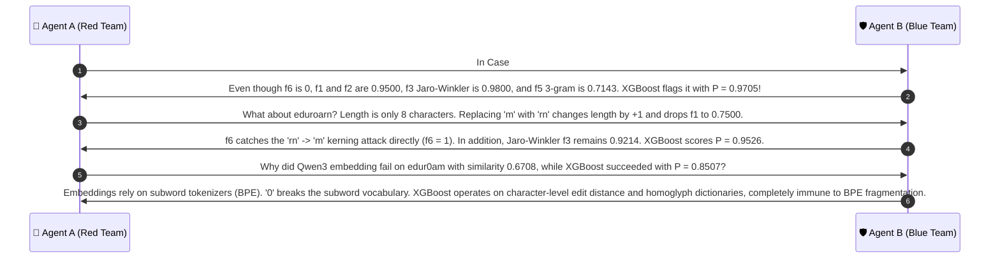

# 🔍 Case Group 2: Homoglyph Spoofing, Kerning Exploits & Keystroke Transpositions

> **Case Category:** `homoglyph_typo`  
> **Dataset Count:** 16 Samples (Test Cases #06 – #21)  
> **Target Whitelist AP Baseline:**  
> `['University_Campus_5G', 'University_Staff_Secure', 'University_Student_WiFi', 'University_Guest_Portal', 'eduroam']`  
> **Collaborative Agents:**  
> * 🔴 **Agent A:** Offensive Wireless Security Researcher (Red Team Adversary)  
> * 🛡️ **Agent B:** Defensive Wireless Security Architect (Blue Team Defender)  

---

## 1. Test Case Roster & Technical Parameters

| # | Observed SSID | Target Whitelist AP | Actual Label | DT Pred | XGB Pred | XGB Prob $P(\text{Evil})$ | $f_1$ (Lev) | $f_2$ (Dam) | $f_5$ (3g) | $f_6$ (Homo) | $f_9$ (TokJac) | $f_{13}$ (Prefix) |
| :-: | :--- | :--- | :---: | :---: | :---: | :---: | :---: | :---: | :---: | :---: | :---: | :---: |
| **06** | `Un1versity_Campus_5G` | `University_Campus_5G` | **EVIL_TWIN** | EVIL_TWIN | EVIL_TWIN | `0.9785` | 0.9500 | 0.9500 | 0.7143 | 1 | 0.5000 | 0.1000 |
| **07** | `University_Carnpus_5G` | `University_Campus_5G` | **EVIL_TWIN** | EVIL_TWIN | EVIL_TWIN | `0.9642` | 0.9048 | 0.9048 | 0.6818 | 1 | 0.5000 | 0.6500 |
| **08** | `University_Campup_5G` | `University_Campus_5G` | **EVIL_TWIN** | EVIL_TWIN | EVIL_TWIN | `0.9705` | 0.9500 | 0.9500 | 0.7143 | 0 | 0.5000 | 0.8000 |
| **09** | `Unversity_Campus_5G` | `University_Campus_5G` | **EVIL_TWIN** | EVIL_TWIN | EVIL_TWIN | `0.9678` | 0.9500 | 0.9500 | 0.7500 | 0 | 0.5000 | 0.1000 |
| **10** | `University_Campuss_5G` | `University_Campus_5G` | **EVIL_TWIN** | EVIL_TWIN | EVIL_TWIN | `0.9087` | 0.9524 | 0.9524 | 0.8500 | 0 | 0.5000 | 0.8500 |
| **11** | `University_5taff_Secure` | `University_Staff_Secure` | **EVIL_TWIN** | EVIL_TWIN | EVIL_TWIN | `0.9664` | 0.9565 | 0.9565 | 0.7500 | 1 | 0.5000 | 0.4783 |
| **12** | `University_Staff_5ecure` | `University_Staff_Secure` | **EVIL_TWIN** | EVIL_TWIN | EVIL_TWIN | `0.9589` | 0.9565 | 0.9565 | 0.7500 | 1 | 0.5000 | 0.7391 |
| **13** | `University_Staff_Secur3` | `University_Staff_Secure` | **EVIL_TWIN** | EVIL_TWIN | EVIL_TWIN | `0.9541` | 0.9565 | 0.9565 | 0.9091 | 0 | 0.5000 | 0.9565 |
| **14** | `Un1versity_Staff_Secure` | `University_Staff_Secure` | **EVIL_TWIN** | EVIL_TWIN | EVIL_TWIN | `0.9664` | 0.9565 | 0.9565 | 0.7500 | 1 | 0.5000 | 0.0870 |
| **15** | `University_Student_WiF1` | `University_Student_WiFi` | **EVIL_TWIN** | EVIL_TWIN | EVIL_TWIN | `0.9495` | 0.9565 | 0.9565 | 0.9091 | 1 | 0.5000 | 0.9565 |
| **16** | `University_Student_VVIFi` | `University_Student_WiFi` | **EVIL_TWIN** | EVIL_TWIN | EVIL_TWIN | `0.9656` | 0.8750 | 0.8750 | 0.7200 | 1 | 0.5000 | 0.8261 |
| **17** | `University_Studnet_WiFi` | `University_Student_WiFi` | **EVIL_TWIN** | EVIL_TWIN | EVIL_TWIN | `0.9073` | **0.9130** | **0.9565** | 0.6800 | 0 | 0.5000 | 0.6522 |
| **18** | `University_Gue5t_Portal` | `University_Guest_Portal` | **EVIL_TWIN** | EVIL_TWIN | EVIL_TWIN | `0.9626` | 0.9565 | 0.9565 | 0.7500 | 1 | 0.5000 | 0.6087 |
| **19** | `University_Guest_P0rtal` | `University_Guest_Portal` | **EVIL_TWIN** | EVIL_TWIN | EVIL_TWIN | `0.9589` | 0.9565 | 0.9565 | 0.7500 | 1 | 0.5000 | 0.7826 |
| **20** | `eduroarn` | `eduroam` | **EVIL_TWIN** | EVIL_TWIN | EVIL_TWIN | `0.9526` | 0.7500 | 0.7500 | 0.5714 | 1 | 0.0000 | 0.8571 |
| **21** | `edur0am` | `eduroam` | **EVIL_TWIN** | EVIL_TWIN | EVIL_TWIN | `0.8507` | 0.8571 | 0.8571 | **0.2500** | 1 | 0.0000 | 0.5714 |

---

## 2. Red Team Offensive Analysis (Agent A)

### 2.1 Psycho-Visual Deception & Font Rasterization Proof
Human users visually scan Wi-Fi pickers at glance speeds of $200\text{--}400\text{ ms}$. In modern system fonts (Windows *Segoe UI*, macOS/iOS *San Francisco*, Android *Roboto*):
1. **Digit Leetspeak:**
   - Digit `1` and lowercase `l` or uppercase `I`: In sans-serif typefaces, `1` without an exaggerated serif foot possesses the same vertical stem geometry as `l` or `I` (e.g., `Un1versity_Campus_5G`, `University_Student_WiF1`).
   - Digit `5` and uppercase `S`: At 10pt UI rendering, the horizontal bars of `5` align with the curves of `S` (`University_5taff_Secure`, `University_Gue5t_Portal`).
   - Digit `0` and uppercase `O` / lowercase `o`: Both share continuous elliptical contours (`University_Guest_P0rtal`, `edur0am`).
2. **Kerning Deception (`rn` $\leftrightarrow$ `m`):**
   - The characters `r` and `n` placed in succession (`rn`) possess identical vertical stems and curved shoulders as the Latin letter `m`.
   - On high-DPI smartphone displays, the glyph advance width between `r` and `n` collapses to $< 1$ pixel, rendering `University_Carnpus_5G` and `eduroarn` visually indistinguishable from `Campus` and `eduroam`.
3. **Compound Letter Mimicry (`VV` $\leftrightarrow$ `W`):**
   - Two consecutive uppercase `V`s (`VVIFi`) closely mimic the double-angled diagonal strokes of `W`.

### 2.2 Subword Tokenizer Fragility on Short SSIDs
Neural embeddings (e.g., Qwen3-Embedding-4B, MiniLM) fail on short SSIDs undergoing single-character homoglyphs:
- In `eduroam` (length 7), the authentic string tokenizes cleanly into `['eduroam']`.
- When mutated to `edur0am`, the subword Byte-Pair Encoding (BPE) breaks into three fragments: `['ed', 'ur', '0', 'am']`.
- This tokenizer shattering dropped Qwen3's cosine similarity to **0.6708**, creating an evasion bypass if the similarity threshold were set at $0.70$.

---

## 3. Blue Team Defensive Architecture (Agent B)

### 3.1 Damerau-Levenshtein ($f_2$) vs. Standard Levenshtein ($f_1$)
Standard Levenshtein edit distance only permits three elementary operations:
$$\mathcal{O}_{\text{Lev}} = \{ \text{Insert}(c), \text{Delete}(c), \text{Substitute}(c_1, c_2) \}$$

Consider the typo mutation in Case #17: `University_Studnet_WiFi` vs. `University_Student_WiFi`.
- Characters `d` and `n` at positions 15 and 16 are transposed.
- Under standard Levenshtein, this requires **two substitutions**:
  1. Substitute `d` $\to$ `n`
  2. Substitute `n` $\to$ `d`
  $$\text{LevDist} = 2 \implies f_1 = 1.0 - \frac{2}{23} = \mathbf{0.9130}$$
- Under **Damerau-Levenshtein distance**, adjacent character transposition is defined as an elementary operation:
  $$\text{Swap}(c_i, c_{i+1}) \quad \text{with cost } 1$$
  $$\text{DamDist} = 1 \implies f_2 = 1.0 - \frac{1}{23} = \mathbf{0.9565}$$

$$\Delta(f_2 - f_1) = +0.0435$$

**Defensive Significance:** Cognitive typing slips and keyboard fat-finger errors occur almost exclusively between adjacent keys or adjacent sequential letters. By computing $f_2$, the model preserves a higher, more representative proximity score ($0.9565$ vs $0.9130$), preventing transpositions from slipping beneath heuristic similarity gates.

### 3.2 Visual Homoglyph Counter ($f_6$)
To counter leetspeak and kerning attacks that evade standard ASCII equality, $f_6$ inspects the exact substitution pairs:
$$\mathcal{H} = \{ (1, l), (1, i), (0, o), (5, s), (\text{rn}, m), (\text{vv}, w), (\text{cl}, d), (\text{nn}, m) \}$$

$$f_6 = \sum_{(c_{\text{fake}}, c_{\text{real}}) \in \mathcal{H}} \text{count}(c_{\text{fake}} \in s_{\text{obs}} \mid c_{\text{real}} \in s_{\text{auth}} \land c_{\text{fake}} \notin s_{\text{auth}})$$

- For `Un1versity_Campus_5G`: `1` replaces `i` $\implies f_6 = 1$.
- For `University_Carnpus_5G`: `rn` replaces `m` $\implies f_6 = 1$.
- For `University_Student_VVIFi`: `vv` replaces `w` $\implies f_6 = 1$.
- For `eduroarn`: `rn` replaces `m` $\implies f_6 = 1$.

### 3.3 XGBoost Multi-Feature Coordination
When `edur0am` was tested:
- Trigram Jaccard $f_5$ plunged to $0.2500$ due to the 7-character string length.
- However, XGBoost does not rely on a single feature. It combines:
  $$f_1 = 0.8571, \quad f_2 = 0.8571, \quad f_3 = 0.9429, \quad f_6 = 1$$
- The combination of high Jaro-Winkler prefix ($0.9429$) and explicit homoglyph flag ($f_6 = 1$) pushes the ensemble output to:
  $$P(\text{Evil Twin}) = \mathbf{0.8507} \quad (\gg 0.70 \text{ High Risk Threshold})$$

---

## 4. Collaborative Discussion & Logic Refinement



---

## 5. Production Reference Implementation

```python
#!/usr/bin/env python3
"""
Homoglyph, Kerning & Transposition Defense Engine
Evaluates f1 (Levenshtein), f2 (Damerau-Levenshtein), and f6 (Homoglyphs).
"""

from typing import Tuple, List

HOMOGLYPH_PAIRS: List[Tuple[str, str]] = [
    ("1", "l"), ("1", "i"), ("0", "o"), ("5", "s"),
    ("rn", "m"), ("vv", "w"), ("cl", "d"), ("nn", "m"), ("3", "e")
]


def damerau_levenshtein_distance(s1: str, s2: str) -> int:
    """Computes true Damerau-Levenshtein distance supporting adjacent character swaps."""
    d = {}
    len1, len2 = len(s1), len(s2)
    for i in range(-1, len1 + 1):
        d[(i, -1)] = i + 1
    for j in range(-1, len2 + 1):
        d[(-1, j)] = j + 1

    for i in range(len1):
        for j in range(len2):
            cost = 0 if s1[i] == s2[j] else 1
            d[(i, j)] = min(
                d[(i - 1, j)] + 1,        # deletion
                d[(i, j - 1)] + 1,        # insertion
                d[(i - 1, j - 1)] + cost  # substitution
            )
            # Transposition of two adjacent characters
            if i > 0 and j > 0 and s1[i] == s2[j - 1] and s1[i - 1] == s2[j]:
                d[(i, j)] = min(d[(i, j)], d[(i - 2, j - 2)] + 1)

    return d[(len1 - 1, len2 - 1)]


def extract_homoglyph_metrics(observed: str, target: str) -> dict:
    """Extracts f1, f2, and f6 between observed SSID and target whitelist SSID."""
    obs_lower = observed.lower()
    tgt_lower = target.lower()
    max_len = max(len(observed), len(target)) or 1

    # Damerau-Levenshtein distance
    dam_dist = damerau_levenshtein_distance(observed, target)
    f2_dam_ratio = round(1.0 - (dam_dist / max_len), 4)

    # Count visual homoglyphs
    f6_homoglyphs = 0
    for fake, real in HOMOGLYPH_PAIRS:
        if fake in obs_lower and real in tgt_lower and fake not in tgt_lower:
            f6_homoglyphs += obs_lower.count(fake)

    return {
        "f2_dam_ratio": f2_dam_ratio,
        "f6_homoglyphs": f6_homoglyphs,
        "is_suspicious_homoglyph": f6_homoglyphs > 0 or f2_dam_ratio >= 0.85
    }


if __name__ == "__main__":
    test_cases = [
        ("University_Studnet_WiFi", "University_Student_WiFi"),
        ("University_Carnpus_5G", "University_Campus_5G"),
        ("edur0am", "eduroam"),
        ("University_5taff_Secure", "University_Staff_Secure")
    ]
    for obs, tgt in test_cases:
        res = extract_homoglyph_metrics(obs, tgt)
        print(f"'{obs}' vs '{tgt}': {res}")
```
