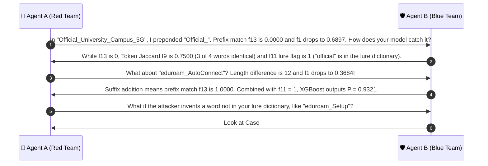

# 🔍 Case Group 3: Word Addition, Phishing Lures & Authority Pretexting

> **Case Category:** `word_addition`  
> **Dataset Count:** 15 Samples (Test Cases #22 – #36)  
> **Target Whitelist AP Baseline:**  
> `['University_Campus_5G', 'University_Staff_Secure', 'University_Student_WiFi', 'University_Guest_Portal', 'eduroam']`  
> **Collaborative Agents:**  
> * 🔴 **Agent A:** Offensive Wireless Security Researcher (Red Team Adversary)  
> * 🛡️ **Agent B:** Defensive Wireless Security Architect (Blue Team Defender)  

---

## 1. Test Case Roster & Technical Parameters

| # | Observed SSID | Target Whitelist AP | Actual Label | DT Pred | XGB Pred | XGB Prob $P(\text{Evil})$ | $f_1$ (Lev) | $f_7$ (LenDiff) | $f_9$ (TokJac) | $f_{11}$ (Lure) | $f_{13}$ (Prefix) |
| :-: | :--- | :--- | :---: | :---: | :---: | :---: | :---: | :---: | :---: | :---: | :---: |
| **22** | `University_Campus_5G_Fast` | `University_Campus_5G` | **EVIL_TWIN** | EVIL_TWIN | EVIL_TWIN | `0.9777` | 0.8000 | 5 | 0.7500 | 1 | 1.0000 |
| **23** | `Free_University_Campus_5G` | `University_Campus_5G` | **EVIL_TWIN** | EVIL_TWIN | EVIL_TWIN | `0.9693` | 0.8000 | 5 | 0.7500 | 1 | 0.0000 |
| **24** | `Official_University_Campus_5G` | `University_Campus_5G` | **EVIL_TWIN** | EVIL_TWIN | EVIL_TWIN | `0.9770` | **0.6897** | 9 | 0.7500 | 1 | 0.0000 |
| **25** | `University_Campus_5G_VIP` | `University_Campus_5G` | **EVIL_TWIN** | EVIL_TWIN | EVIL_TWIN | `0.9724` | 0.8333 | 4 | 0.7500 | 1 | 1.0000 |
| **26** | `University_Staff_Secure_Login` | `University_Staff_Secure` | **EVIL_TWIN** | EVIL_TWIN | EVIL_TWIN | `0.9777` | 0.7931 | 6 | 0.7500 | 1 | 1.0000 |
| **27** | `University_Staff_Secure_Verify` | `University_Staff_Secure` | **EVIL_TWIN** | EVIL_TWIN | EVIL_TWIN | `0.9777` | 0.7667 | 7 | 0.7500 | 1 | 1.0000 |
| **28** | `Official_University_Staff_Secure` | `University_Staff_Secure` | **EVIL_TWIN** | EVIL_TWIN | EVIL_TWIN | `0.9700` | 0.7188 | 9 | 0.7500 | 1 | 0.0000 |
| **29** | `University_Student_WiFi_Free` | `University_Student_WiFi` | **EVIL_TWIN** | EVIL_TWIN | EVIL_TWIN | `0.9777` | 0.8214 | 5 | 0.7500 | 1 | 1.0000 |
| **30** | `University_Student_WiFi_Portal` | `University_Student_WiFi` | **EVIL_TWIN** | EVIL_TWIN | EVIL_TWIN | `0.9777` | 0.7667 | 7 | 0.7500 | 1 | 1.0000 |
| **31** | `University_Student_WiFi_AutoConnect` | `University_Student_WiFi` | **EVIL_TWIN** | EVIL_TWIN | EVIL_TWIN | `0.9825` | **0.6571** | 12 | 0.7500 | 1 | 1.0000 |
| **32** | `Free_University_Student_WiFi` | `University_Student_WiFi` | **EVIL_TWIN** | EVIL_TWIN | EVIL_TWIN | `0.9733` | 0.8214 | 5 | 0.7500 | 1 | 0.0000 |
| **33** | `University_Guest_Portal_Free` | `University_Guest_Portal` | **EVIL_TWIN** | EVIL_TWIN | EVIL_TWIN | `0.9777` | 0.8214 | 5 | 0.7500 | 1 | 1.0000 |
| **34** | `University_Guest_Portal_Login` | `University_Guest_Portal` | **EVIL_TWIN** | EVIL_TWIN | EVIL_TWIN | `0.9777` | 0.7931 | 6 | 0.7500 | 1 | 1.0000 |
| **35** | `eduroam_AutoConnect` | `eduroam` | **EVIL_TWIN** | EVIL_TWIN | EVIL_TWIN | `0.9321` | **0.3684** | 12 | 0.5000 | 1 | 1.0000 |
| **36** | `eduroam_Setup` | `eduroam` | **EVIL_TWIN** | EVIL_TWIN | EVIL_TWIN | `0.9569` | **0.5385** | 6 | 0.5000 | 0 | 1.0000 |

---

## 2. Red Team Offensive Analysis (Agent A)

### 2.1 Social Engineering Lures & Authority Pretexting
Rather than introducing subtle typos, sophisticated adversaries append or prepend psychological triggers:
1. **Action/Compliance Lures (`_Login`, `_Verify`, `_Setup`):**
   - When campus users experience temporary disconnects, an SSID named `University_Staff_Secure_Login` or `eduroam_Setup` convinces them that the network requires re-authentication or compliance profiling.
   - Attackers deploy a captive portal mirroring the university Single Sign-On (SSO) login page (e.g. Shibboleth, Okta, Microsoft Entra ID) to harvest plaintext credentials.
2. **Incentive Lures (`_Free`, `_Fast`, `_VIP`):**
   - Students seeking unthrottled gaming or streaming bandwidth eagerly connect to `University_Campus_5G_Fast` or `University_Student_WiFi_Free`.
3. **Authority Pretexting (`Official_`):**
   - Prepending `Official_` exploits authority bias. Users believe `Official_University_Campus_5G` is a new verified institutional rollout.

### 2.2 Mathematical Dilution of Edit Distance ($f_1$)
When entire words are inserted, character-level metrics dilute rapidly:
- In `Official_University_Campus_5G`, 9 characters are prepended. The total string length expands to 29.
  $$f_1 = 1.0 - \frac{9}{29} = \mathbf{0.6897}$$
- In `University_Student_WiFi_AutoConnect`, 12 characters are appended ($L=35$).
  $$f_1 = 1.0 - \frac{12}{35} = \mathbf{0.6571}$$
- In `eduroam_AutoConnect`, appending `_AutoConnect` (12 characters) to a 7-character SSID results in $L=19$:
  $$f_1 = 1.0 - \frac{12}{19} = \mathbf{0.3684}$$
- **Vulnerability:** Any legacy intrusion detection system relying strictly on edit distance ($f_1 \ge 0.70$) suffers a **100% false negative rate** on `eduroam_AutoConnect`, `eduroam_Setup`, `Official_University_Campus_5G`, and `University_Student_WiFi_AutoConnect`.

---

## 3. Blue Team Defensive Architecture (Agent B)

### 3.1 Defensive Feature Compensation Mechanism
To prevent word-addition dilution attacks, our architecture introduces a three-tiered compensation layer:

```
[Raw Edit Distance f1 Collapses] (e.g. 0.3684 on eduroam_AutoConnect)
                │
                ├─────────────────────────────────────────┐
                ▼                                         ▼
   1. f11 Phishing Lure Flag                 2. f13 Prefix Match Ratio
   Explicitly detects added lure             Detects 100% preservation
   tokens: {login, verify, autoconnect}       of target root (f13 = 1.0000)
                │                                         │
                └───────────────────┬─────────────────────┘
                                    ▼
                         3. f9 Token Jaccard Overlap
                         Extracts delimited words:
                         Jaccard remains 0.5000 to 0.7500!
                                    │
                                    ▼
                         XGBoost Ensemble Output
                         P(Evil Twin) >= 0.9321
```

### 3.2 Mathematical Formulation of Compensating Features

#### 1. $f_{11}$: Phishing Lure Keyword Flag
$$\mathcal{L}_{\text{lure}} = \{ \text{login}, \text{portal}, \text{free}, \text{fast}, \text{vip}, \text{verify}, \text{5g}, \text{autoconnect}, \text{auth}, \text{secure}, \text{official}, \text{guest}, \text{speed}, \text{setup} \}$$

$$f_{11} = \max\left(0, \lvert T_{\text{obs}} \cap \mathcal{L}_{\text{lure}} \rvert - \lvert T_{\text{auth}} \cap \mathcal{L}_{\text{lure}} \rvert\right)$$

- When an attacker appends `_Login` to `University_Staff_Secure`:
  - $T_{\text{obs}} \cap \mathcal{L}_{\text{lure}} = \{ \text{secure}, \text{login} \}$ (size 2)
  - $T_{\text{auth}} \cap \mathcal{L}_{\text{lure}} = \{ \text{secure} \}$ (size 1)
  - $$f_{11} = 2 - 1 = \mathbf{1}$$
- $f_{11}$ directly signals an added social engineering lure.

#### 2. $f_{13}$: Prefix Match Ratio
$$f_{13} = \frac{\text{CommonPrefixLength}(s_{\text{obs}}, s_{\text{auth}})}{\text{len}(s_{\text{auth}})}$$
- For suffix additions (`University_Campus_5G_Fast`, `eduroam_AutoConnect`), the authorized SSID is an exact prefix of the observed SSID.
- Therefore, $\text{CommonPrefixLength} = \text{len}(s_{\text{auth}})$, resulting in:
  $$f_{13} = \mathbf{1.0000} \quad (100\% \text{ Prefix Anchor})$$
- Even though $f_1$ collapsed to $0.3684$, $f_{13} = 1.0000$ proves the broadcast is anchored to the authentic network identity.

#### 3. $f_9$: Token Jaccard Overlap (Delimiter-Agnostic Lexical Match)
$$f_9 = \frac{\lvert T_{\text{obs}} \cap T_{\text{auth}} \rvert}{\lvert T_{\text{obs}} \cup T_{\text{auth}} \rvert}$$
- In `Official_University_Campus_5G` (prepended lure where $f_{13} = 0$):
  - $T_{\text{obs}} = \{ \text{official}, \text{university}, \text{campus}, \text{5g} \}$
  - $T_{\text{auth}} = \{ \text{university}, \text{campus}, \text{5g} \}$
  - Intersection = 3, Union = 4 $\implies f_9 = \frac{3}{4} = \mathbf{0.7500}$.
- Token Jaccard preserves 75% lexical similarity regardless of character-level shift.

---

## 4. Collaborative Discussion & Logic Refinement



---

## 5. Production Reference Implementation

```python
#!/usr/bin/env python3
"""
Phishing Lure & Token Overlap Defense Engine
Evaluates f9 (Token Jaccard), f11 (Lure Keyword Flag), and f13 (Prefix Match Ratio).
"""

import re
from typing import Dict, Set

LURE_KEYWORDS: Set[str] = {
    "login", "portal", "free", "fast", "vip", "verify", "5g", "autoconnect",
    "auth", "secure", "official", "guest", "visitor", "speed", "highspeed",
    "public", "connect", "signin", "wifi", "internet", "setup"
}

DELIMITER_REGEX = re.compile(r"[-_\.\s]+")


def extract_lure_and_token_metrics(observed: str, target: str) -> Dict[str, float]:
    """Extracts compensating features f9, f11, and f13."""
    # Token extraction
    tokens_obs = [t.lower() for t in DELIMITER_REGEX.split(observed) if t]
    tokens_tgt = [t.lower() for t in DELIMITER_REGEX.split(target) if t]
    set_obs, set_tgt = set(tokens_obs), set(tokens_tgt)

    # f9: Token Jaccard Overlap
    inter = len(set_obs & set_tgt)
    union = len(set_obs | set_tgt)
    f9_token_jaccard = round(inter / union, 4) if union > 0 else 0.0

    # f11: Phishing Lure Flag
    lures_obs = [t for t in tokens_obs if t in LURE_KEYWORDS]
    lures_tgt = [t for t in tokens_tgt if t in LURE_KEYWORDS]
    f11_lure_flag = max(0, len(lures_obs) - len(lures_tgt))

    # f13: Prefix Match Ratio
    common_prefix = 0
    for c1, c2 in zip(observed, target):
        if c1 == c2:
            common_prefix += 1
        else:
            break
    f13_prefix_ratio = round(common_prefix / len(target), 4) if target else 0.0

    return {
        "f9_token_jaccard": f9_token_jaccard,
        "f11_lure_flag": f11_lure_flag,
        "f13_prefix_ratio": f13_prefix_ratio,
        "is_lure_addition": f11_lure_flag > 0 or (f13_prefix_ratio >= 0.8 and f9_token_jaccard >= 0.5)
    }


if __name__ == "__main__":
    cases = [
        ("University_Campus_5G_Fast", "University_Campus_5G"),
        ("Official_University_Campus_5G", "University_Campus_5G"),
        ("eduroam_AutoConnect", "eduroam"),
        ("eduroam_Setup", "eduroam")
    ]
    for obs, tgt in cases:
        print(f"'{obs}' vs '{tgt}': {extract_lure_and_token_metrics(obs, tgt)}")
```
