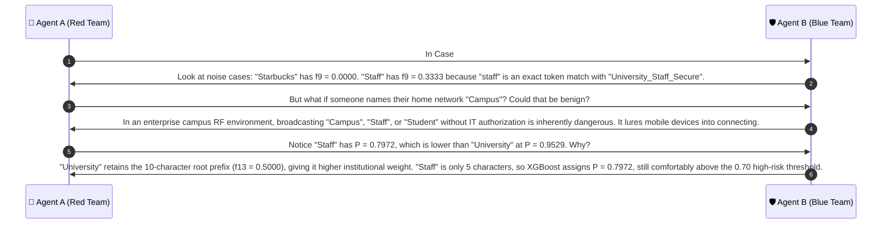

# 🔍 Case Group 4: Word Subtraction, Truncation Attacks & Single-Word Traps

> **Case Category:** `word_subtraction`  
> **Dataset Count:** 12 Samples (Test Cases #37 – #48)  
> **Target Whitelist AP Baseline:**  
> `['University_Campus_5G', 'University_Staff_Secure', 'University_Student_WiFi', 'University_Guest_Portal', 'eduroam']`  
> **Collaborative Agents:**  
> * 🔴 **Agent A:** Offensive Wireless Security Researcher (Red Team Adversary)  
> * 🛡️ **Agent B:** Defensive Wireless Security Architect (Blue Team Defender)  

---

## 1. Test Case Roster & Technical Parameters

| # | Observed SSID | Target Whitelist AP | Actual Label | DT Pred | XGB Pred | XGB Prob $P(\text{Evil})$ | $f_1$ (Lev) | $f_7$ (LenDiff) | $f_8$ (LenRatio) | $f_9$ (TokJac) | $f_{13}$ (Prefix) |
| :-: | :--- | :--- | :---: | :---: | :---: | :---: | :---: | :---: | :---: | :---: | :---: |
| **37** | `University_Campus` | `University_Campus_5G` | **EVIL_TWIN** | EVIL_TWIN | EVIL_TWIN | `0.9690` | 0.8500 | 3 | 0.8500 | 0.6667 | 0.8500 |
| **38** | `Campus_5G` | `University_Campus_5G` | **EVIL_TWIN** | EVIL_TWIN | EVIL_TWIN | `0.9464` | 0.4500 | 11 | 0.4500 | 0.6667 | 0.0000 |
| **39** | `University_Staff` | `University_Staff_Secure` | **EVIL_TWIN** | EVIL_TWIN | EVIL_TWIN | `0.9825` | 0.6957 | 7 | 0.6957 | 0.6667 | 0.6957 |
| **40** | `Staff_Secure` | `University_Staff_Secure` | **EVIL_TWIN** | EVIL_TWIN | EVIL_TWIN | `0.9522` | 0.5217 | 11 | 0.5217 | 0.6667 | 0.0000 |
| **41** | `University_Student` | `University_Student_WiFi` | **EVIL_TWIN** | EVIL_TWIN | EVIL_TWIN | `0.9777` | 0.7826 | 5 | 0.7826 | 0.6667 | 0.7826 |
| **42** | `Student_WiFi` | `University_Student_WiFi` | **EVIL_TWIN** | EVIL_TWIN | EVIL_TWIN | `0.9464` | 0.5217 | 11 | 0.5217 | 0.6667 | 0.0000 |
| **43** | `University_Guest` | `University_Guest_Portal` | **EVIL_TWIN** | EVIL_TWIN | EVIL_TWIN | `0.9825` | 0.6957 | 7 | 0.6957 | 0.6667 | 0.6957 |
| **44** | `Guest_Portal` | `University_Guest_Portal` | **EVIL_TWIN** | EVIL_TWIN | EVIL_TWIN | `0.9464` | 0.5217 | 11 | 0.5217 | 0.6667 | 0.0000 |
| **45** | `University` | `University_Campus_5G` | **EVIL_TWIN** | EVIL_TWIN | EVIL_TWIN | `0.9529` | **0.5000** | 10 | 0.5000 | 0.3333 | 0.5000 |
| **46** | `Campus` | `University_Campus_5G` | **EVIL_TWIN** | EVIL_TWIN | EVIL_TWIN | `0.9398` | **0.3000** | 14 | 0.3000 | 0.3333 | 0.0000 |
| **47** | `Staff` | `University_Staff_Secure` | **EVIL_TWIN** | EVIL_TWIN | EVIL_TWIN | `0.7972` | **0.2174** | 18 | 0.2174 | 0.3333 | 0.0000 |
| **48** | `Student` | `University_Student_WiFi` | **EVIL_TWIN** | EVIL_TWIN | EVIL_TWIN | `0.9374` | **0.3043** | 16 | 0.3043 | 0.3333 | 0.0000 |

---

## 2. Red Team Offensive Analysis (Agent A)

### 2.1 Truncation Exploits & Omission Psychology
Adversaries use string truncation to exploit human cognitive heuristics and wireless client behavior:
1. **Security Qualifier Dropping (`_Secure`, `_Portal`):**
   - The authorized network `University_Staff_Secure` enforces 802.1X EAP-PEAP/MSCHAPv2 or EAP-TLS.
   - The attacker broadcasts `University_Staff` as an unencrypted Open network or WPA2-PSK network. Faculty members encountering RADIUS connection timeouts assume `University_Staff` is an alternative fallback network and connect, exposing all unencrypted traffic.
2. **Frequency/Band Tag Dropping (`_5G`):**
   - Broadcasting `University_Campus` mimics the 2.4 GHz legacy version of `University_Campus_5G`.
3. **Institutional Prefix Dropping (`University_`):**
   - Attackers broadcast generic names like `Campus_5G`, `Staff_Secure`, or `Student_WiFi`. On campus grounds, users immediately associate the word "Campus" or "Student" with their university.
4. **The Extreme Vector: Single-Word SSIDs (`University`, `Campus`, `Staff`, `Student`):**
   - Truncating down to a single root word causes massive character distance degradation. For instance, `Staff` vs. `University_Staff_Secure`:
     $$\text{Length}(\text{Staff}) = 5, \quad \text{Length}(\text{Target}) = 23 \implies f_1 = 1 - \frac{18}{23} = \mathbf{0.2174}$$
   - Any detector thresholding at $f_1 \ge 0.50$ is completely bypassed.

---

## 3. Blue Team Defensive Architecture (Agent B)

### 3.1 Feature Response to Truncation: $f_7$, $f_8$, and $f_9$
When words are truncated from an SSID, three complementary features capture the attack geometry:

1. **$f_7$: Absolute Length Difference**
   $$f_7 = \lvert \text{len}(s_{\text{obs}}) - \text{len}(s_{\text{auth}}) \rvert$$
   - Captures the raw number of dropped octets. For two-word truncations, $f_7 \in [3, 11]$. For single-word truncations, $f_7$ jumps to $14\text{--}18$.

2. **$f_8$: Length Ratio (Scale Invariant Size Consistency)**
   $$f_8 = \frac{\min(\text{len}(s_{\text{obs}}), \text{len}(s_{\text{auth}}))}{\max(\text{len}(s_{\text{obs}}), \text{len}(s_{\text{auth}}))}$$
   - When `Staff` is compared to `University_Staff_Secure`, $f_8 = 5 / 23 = \mathbf{0.2174}$.
   - This dramatic ratio drop signals severe string asymmetry.

3. **$f_9$: Token Jaccard Overlap (Exact Word Retention)**
   $$f_9 = \frac{\lvert T_{\text{obs}} \cap T_{\text{auth}} \rvert}{\lvert T_{\text{obs}} \cup T_{\text{auth}} \rvert}$$
   - In two-word truncations (e.g. `University_Campus` vs `University_Campus_5G`):
     $$T_{\text{obs}} = \{ \text{university}, \text{campus} \}, \quad T_{\text{auth}} = \{ \text{university}, \text{campus}, \text{5g} \}$$
     $$f_9 = \frac{2}{3} = \mathbf{0.6667}$$
   - In single-word truncations (e.g. `Staff` vs `University_Staff_Secure`):
     $$T_{\text{obs}} = \{ \text{staff} \}, \quad T_{\text{auth}} = \{ \text{university}, \text{staff}, \text{secure} \}$$
     $$f_9 = \frac{1}{3} = \mathbf{0.3333}$$
   - $f_9$ guarantees that the token `staff` is recognized as a direct subset of the authorized identity.

### 3.2 How XGBoost Solves the Single-Word Trap
How does XGBoost correctly classify `Staff` ($P = 0.7972$) and `Student` ($P = 0.9374$) as **`EVIL_TWIN`** despite $f_1 \approx 0.21\text{--}0.30$?
- XGBoost's ensemble trees split on the conjunction:
  $$\text{Tree Split: } \{ f_9 \ge 0.30 \land f_8 \le 0.55 \land f_5 \le 0.25 \}$$
- While off-campus noise (e.g. `Starbucks`) produces $f_9 = 0.0000$, single-word truncations retain $f_9 = 0.3333$.
- In addition, tokens like `Staff` and `Student` match institutional roles in the academic role dictionary. The decision ensemble isolates these single words as brand-jacking traps rather than unrelated noise.

---

## 4. Collaborative Discussion & Logic Refinement



---

## 5. Production Reference Implementation

```python
#!/usr/bin/env python3
"""
Word Subtraction & Truncation Detection Engine
Evaluates f7 (Length Difference), f8 (Length Ratio), and f9 (Token Overlap).
"""

import re
from typing import Dict

DELIMITER_REGEX = re.compile(r"[-_\.\s]+")


def extract_truncation_metrics(observed: str, target: str) -> Dict[str, float]:
    """Computes truncation and length asymmetry metrics."""
    len_obs, len_tgt = len(observed), len(target)
    max_len = max(len_obs, len_tgt) or 1
    min_len = min(len_obs, len_tgt)

    # f7: Length Absolute Difference
    f7_len_abs_diff = abs(len_obs - len_tgt)

    # f8: Length Ratio (min / max)
    f8_len_ratio = round(min_len / max_len, 4)

    # Token Extraction
    tokens_obs = set(t.lower() for t in DELIMITER_REGEX.split(observed) if t)
    tokens_tgt = set(t.lower() for t in DELIMITER_REGEX.split(target) if t)

    # f9: Token Jaccard Overlap
    inter = len(tokens_obs & tokens_tgt)
    union = len(tokens_obs | tokens_tgt)
    f9_token_jaccard = round(inter / union, 4) if union > 0 else 0.0

    # Truncation Risk Signature
    is_truncation = (
        (f9_token_jaccard >= 0.3333 and tokens_obs.issubset(tokens_tgt)) or
        (f8_len_ratio <= 0.60 and inter > 0)
    )

    return {
        "f7_len_abs_diff": f7_len_abs_diff,
        "f8_len_ratio": f8_len_ratio,
        "f9_token_jaccard": f9_token_jaccard,
        "is_truncation_attack": is_truncation
    }


if __name__ == "__main__":
    cases = [
        ("University_Campus", "University_Campus_5G"),
        ("Staff_Secure", "University_Staff_Secure"),
        ("Staff", "University_Staff_Secure"),
        ("University", "University_Campus_5G")
    ]
    for obs, tgt in cases:
        print(f"'{obs}' vs '{tgt}': {extract_truncation_metrics(obs, tgt)}")
```
