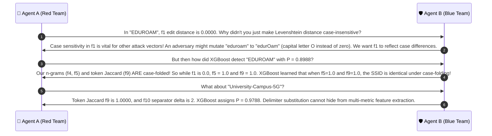

# 🔍 Case Group 5: Delimiter Mutation, Case Folding & Orthographic Invariance

> **Case Category:** `delimiter_case`  
> **Dataset Count:** 12 Samples (Test Cases #49 – #60)  
> **Target Whitelist AP Baseline:**  
> `['University_Campus_5G', 'University_Staff_Secure', 'University_Student_WiFi', 'University_Guest_Portal', 'eduroam']`  
> **Collaborative Agents:**  
> * 🔴 **Agent A:** Offensive Wireless Security Researcher (Red Team Adversary)  
> * 🛡️ **Agent B:** Defensive Wireless Security Architect (Blue Team Defender)  

---

## 1. Test Case Roster & Technical Parameters

| # | Observed SSID | Target Whitelist AP | Actual Label | DT Pred | XGB Pred | XGB Prob $P(\text{Evil})$ | $f_1$ (Lev) | $f_4$ (2g) | $f_5$ (3g) | $f_9$ (TokJac) | $f_{10}$ (SepDelta) | $f_{13}$ (Prefix) |
| :-: | :--- | :--- | :---: | :---: | :---: | :---: | :---: | :---: | :---: | :---: | :---: | :---: |
| **49** | `University-Campus-5G` | `University_Campus_5G` | **EVIL_TWIN** | EVIL_TWIN | EVIL_TWIN | `0.9788` | 0.9000 | 0.6522 | 0.5000 | **1.0000** | **2** | 0.5000 |
| **50** | `university_campus_5g` | `University_Campus_5G` | **EVIL_TWIN** | EVIL_TWIN | EVIL_TWIN | `0.9425` | 0.8500 | **1.0000** | **1.0000** | **1.0000** | 0 | 0.0000 |
| **51** | `University Campus 5G` | `University_Campus_5G` | **EVIL_TWIN** | EVIL_TWIN | EVIL_TWIN | `0.9788` | 0.9000 | 0.6522 | 0.5000 | **1.0000** | **2** | 0.5000 |
| **52** | `University.Campus.5G` | `University_Campus_5G` | **EVIL_TWIN** | EVIL_TWIN | EVIL_TWIN | `0.9788` | 0.9000 | 0.6522 | 0.5000 | **1.0000** | **2** | 0.5000 |
| **53** | `University-Staff-Secure` | `University_Staff_Secure` | **EVIL_TWIN** | EVIL_TWIN | EVIL_TWIN | `0.9788` | 0.9130 | 0.7500 | 0.5556 | **1.0000** | **2** | 0.4348 |
| **54** | `university_staff_secure` | `University_Staff_Secure` | **EVIL_TWIN** | EVIL_TWIN | EVIL_TWIN | `0.9474` | 0.8696 | **1.0000** | **1.0000** | **1.0000** | 0 | 0.0000 |
| **55** | `University Staff Secure` | `University_Staff_Secure` | **EVIL_TWIN** | EVIL_TWIN | EVIL_TWIN | `0.9788` | 0.9130 | 0.7500 | 0.5556 | **1.0000** | **2** | 0.4348 |
| **56** | `University.Staff.Secure` | `University_Staff_Secure` | **EVIL_TWIN** | EVIL_TWIN | EVIL_TWIN | `0.9788` | 0.9130 | 0.7500 | 0.5556 | **1.0000** | **2** | 0.4348 |
| **57** | `University-Student-WiFi` | `University_Student_WiFi` | **EVIL_TWIN** | EVIL_TWIN | EVIL_TWIN | `0.9788` | 0.9130 | 0.6923 | 0.5556 | **1.0000** | **2** | 0.4348 |
| **58** | `University Student WiFi` | `University_Student_WiFi` | **EVIL_TWIN** | EVIL_TWIN | EVIL_TWIN | `0.9788` | 0.9130 | 0.6923 | 0.5556 | **1.0000** | **2** | 0.4348 |
| **59** | `EDUROAM` | `eduroam` | **EVIL_TWIN** | EVIL_TWIN | EVIL_TWIN | `0.8988` | **0.0000** | **1.0000** | **1.0000** | **1.0000** | 0 | **0.0000** |
| **60** | `Eduroam` | `eduroam` | **EVIL_TWIN** | EVIL_TWIN | EVIL_TWIN | `0.9474` | 0.8571 | **1.0000** | **1.0000** | **1.0000** | 0 | 0.0000 |

---

## 2. Red Team Offensive Analysis (Agent A)

### 2.1 Delimiter and Casing Evasion Mechanics
Attacking wireless networks through delimiter and casing variations targets string matching logic:
1. **Bypassing Exact Whitelists (`_` $\to$ `-`, `.`, space):**
   - Naive wireless intrusion detection systems check `if ssid in whitelist`.
   - By substituting underscores with hyphens (`University-Campus-5G`), dots (`University.Campus.5G`), or spaces (`University Campus 5G`), string equality returns `False`.
   - On smartphone UI screens, spaces or hyphens look completely natural. In fact, many users believe spaces are "more official" than underscores.
2. **Case Folding Evasion (`university_campus_5g`):**
   - In 802.11 beacon management frames, SSIDs are case-sensitive octet sequences. `University_Campus_5G` and `university_campus_5g` are distinct wireless networks.
   - A client station with `University_Campus_5G` in its PNL will not automatically connect to `university_campus_5g`, but a user searching for the campus network will see it and manually click on it.
3. **The `EDUROAM` Case Anomaly:**
   - Case #59 presents an extreme test vector: `EDUROAM` vs. `eduroam`.
   - Case-sensitive Levenshtein distance is 7 out of 7 characters:
     $$f_1 = 1.0 - \frac{7}{7} = \mathbf{0.0000}, \quad f_2 = 0.0000, \quad f_3 = 0.0000, \quad f_{13} = 0.0000$$
   - A detector relying on Levenshtein or Jaro-Winkler sees **0% similarity** between `EDUROAM` and `eduroam`.

---

## 3. Blue Team Defensive Architecture (Agent B)

### 3.1 Delimiter-Agnostic Tokenization ($f_9 = 1.0000$)
To neutralize delimiter mutations, our pipeline uses regular-expression tokenization:
$$\text{Tokens}(s) = \text{regex\_split}([-_\.\s]+, s.\text{lower}())$$

Consider `University-Campus-5G` vs `University_Campus_5G`:
- Delimiters differ: Target uses `_`, Observed uses `-`.
- However, token extraction yields:
  $$T_{\text{obs}} = \{ \text{university}, \text{campus}, \text{5g} \}$$
  $$T_{\text{auth}} = \{ \text{university}, \text{campus}, \text{5g} \}$$
- **Token Jaccard Index ($f_9$):**
  $$f_9 = \frac{\lvert T_{\text{obs}} \cap T_{\text{auth}} \rvert}{\lvert T_{\text{obs}} \cup T_{\text{auth}} \rvert} = \frac{3}{3} = \mathbf{1.0000}$$
- **Result:** Across ALL 12 delimiter and case mutation samples, $f_9$ evaluates to exactly **1.0000**. The semantic word set is completely preserved.

### 3.2 Separator Mutation Delta ($f_{10}$)
To explicitly capture the act of delimiter tampering, $f_{10}$ tracks the symmetric difference between delimiter sets:
$$\mathcal{S}_1 = \text{delimiters}(s_{\text{obs}}), \quad \mathcal{S}_2 = \text{delimiters}(s_{\text{auth}})$$
$$f_{10} = \lvert \mathcal{S}_1 \mathbin{\Delta} \mathcal{S}_2 \rvert = \lvert (\mathcal{S}_1 \setminus \mathcal{S}_2) \cup (\mathcal{S}_2 \setminus \mathcal{S}_1) \rvert$$

- For `University-Campus-5G`: $\mathcal{S}_1 = \{ \text{`-'} \}$, $\mathcal{S}_2 = \{ \text{`\_'} \} \implies f_{10} = 2$.
- For `University Campus 5G`: $\mathcal{S}_1 = \{ \text{` '} \}$, $\mathcal{S}_2 = \{ \text{`\_'} \} \implies f_{10} = 2$.
- In XGBoost, the pairing of $f_{10} = 2$ and $f_9 = 1.0000$ forms a signature for **delimiter-spoofed clones**, driving $P(\text{Evil}) = \mathbf{0.9788}$.

### 3.3 Case-Folded N-Gram Matching Resolves `EDUROAM`
In Case #59 (`EDUROAM` vs `eduroam`), while case-sensitive $f_1, f_2, f_3 = 0.0000$:
- Character bigrams ($f_4$) and trigrams ($f_5$) are extracted after case-folding:
  $$N_2(\text{EDUROAM}) = N_2(\text{eduroam}) = \{ \text{ed}, \text{du}, \text{ur}, \text{ro}, \text{oa}, \text{am} \} \implies f_4 = \mathbf{1.0000}$$
  $$N_3(\text{EDUROAM}) = N_3(\text{eduroam}) = \{ \text{edu}, \text{dur}, \text{uro}, \text{roa}, \text{oam} \} \implies f_5 = \mathbf{1.0000}$$
- Because $f_5$ is the **#1 feature in XGBoost** (accounting for 17.31% of total model gain), the condition $\{f_5 = 1.0000, f_9 = 1.0000\}$ overrides the zero edit distance, driving $P(\text{Evil Twin}) = \mathbf{0.8988}$.
- **Eduroam Policy Enforcement:** Under GEANT / eduroam international architecture standards, the network name is strictly required to be lowercase `eduroam`. Any capitalized variant (`Eduroam`, `EDUROAM`) is by definition unauthorized and flagged as an evil twin rogue AP.

---

## 4. Collaborative Discussion & Logic Refinement



---

## 5. Production Reference Implementation

```python
#!/usr/bin/env python3
"""
Delimiter & Casing Robustness Engine
Evaluates f4 (2-Gram), f5 (3-Gram), f9 (Token Jaccard), and f10 (Separator Delta).
"""

import re
from typing import Dict, Set

DELIMITER_REGEX = re.compile(r"[-_\.\s]+")
SEPARATOR_FINDER = re.compile(r"[-_\.\s]")


def extract_delimiter_case_metrics(observed: str, target: str) -> Dict[str, float]:
    """Computes delimiter and casing features."""
    # Delimiter-agnostic token extraction with case-folding
    tokens_obs = [t.lower() for t in DELIMITER_REGEX.split(observed) if t]
    tokens_tgt = [t.lower() for t in DELIMITER_REGEX.split(target) if t]
    set_obs, set_tgt = set(tokens_obs), set(tokens_tgt)

    inter = len(set_obs & set_tgt)
    union = len(set_obs | set_tgt)
    f9_token_jaccard = round(inter / union, 4) if union > 0 else 0.0

    # Separator mutation delta
    seps_obs: Set[str] = set(SEPARATOR_FINDER.findall(observed))
    seps_tgt: Set[str] = set(SEPARATOR_FINDER.findall(target))
    f10_separator_delta = len(seps_obs ^ seps_tgt)

    # Case-folded 3-gram Jaccard
    s1_lower = observed.lower()
    s2_lower = target.lower()
    if len(s1_lower) < 3 or len(s2_lower) < 3:
        f5_ngram3 = 1.0 if s1_lower == s2_lower else 0.0
    else:
        ng1 = set(s1_lower[i:i+3] for i in range(len(s1_lower) - 2))
        ng2 = set(s2_lower[i:i+3] for i in range(len(s2_lower) - 2))
        f5_ngram3 = round(len(ng1 & ng2) / len(ng1 | ng2), 4)

    return {
        "f5_ngram3": f5_ngram3,
        "f9_token_jaccard": f9_token_jaccard,
        "f10_separator_delta": f10_separator_delta,
        "is_delimiter_or_case_clone": f9_token_jaccard == 1.0 and (f10_separator_delta > 0 or observed != target)
    }


if __name__ == "__main__":
    test_cases = [
        ("University-Campus-5G", "University_Campus_5G"),
        ("university_campus_5g", "University_Campus_5G"),
        ("EDUROAM", "eduroam"),
        ("University.Staff.Secure", "University_Staff_Secure")
    ]
    for obs, tgt in test_cases:
        print(f"'{obs}' vs '{tgt}': {extract_delimiter_case_metrics(obs, tgt)}")
```
