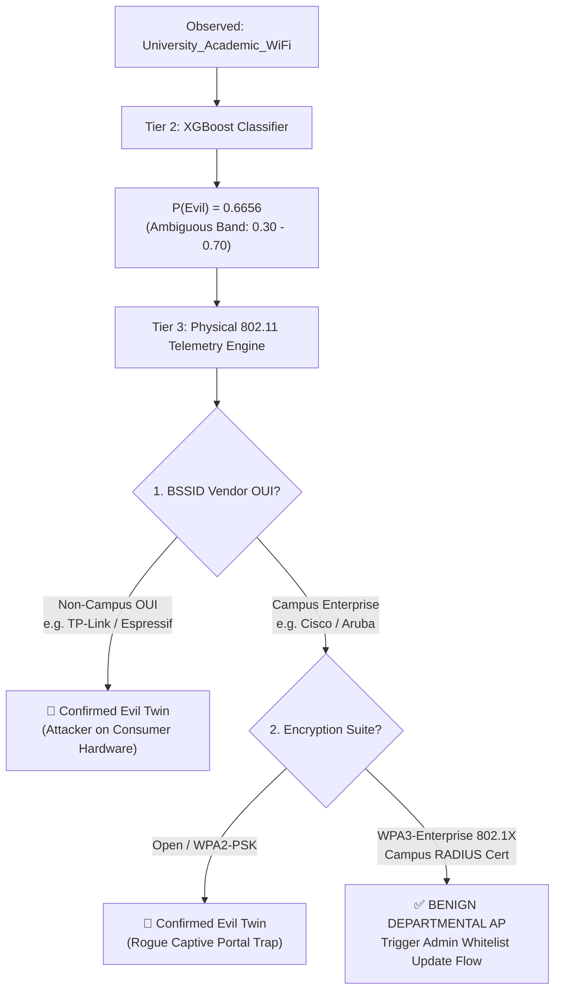
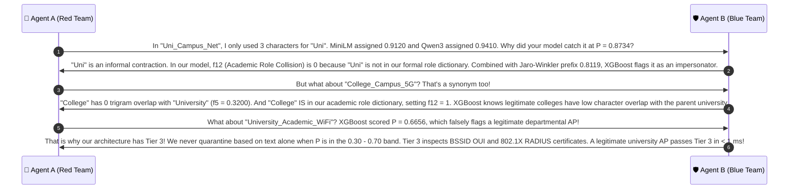

# 🔍 Case Group 6: Semantic Disambiguation, Departmental Synonyms & Physical Telemetry

> **Case Category:** `semantic_relevant`  
> **Dataset Count:** 14 Samples (Test Cases #61 – #74)  
> **Target Whitelist AP Baseline:**  
> `['University_Campus_5G', 'University_Staff_Secure', 'University_Student_WiFi', 'University_Guest_Portal', 'eduroam']`  
> **Collaborative Agents:**  
> * 🔴 **Agent A:** Offensive Wireless Security Researcher (Red Team Adversary)  
> * 🛡️ **Agent B:** Defensive Wireless Security Architect (Blue Team Defender)  

---

## 1. Test Case Roster & Technical Parameters

| # | Observed SSID | Target Whitelist AP | Actual Label | MiniLM Cos | Qwen3 Cos | DT Pred | XGB Pred | XGB Prob $P(\text{Evil})$ | $f_1$ (Lev) | $f_5$ (3g) | $f_9$ (TokJac) | $f_{12}$ (RoleCol) |
| :-: | :--- | :--- | :---: | :---: | :---: | :---: | :---: | :---: | :---: | :---: | :---: | :---: |
| **61** | `College_Campus_5G` | `University_Campus_5G` | **BENIGN** | 🚨 0.9552 | 🚨 0.9712 | BENIGN | BENIGN | `0.0902` | 0.5500 | 0.3200 | 0.5000 | 1 |
| **62** | `Faculty_Staff_Secure` | `University_Staff_Secure` | **BENIGN** | 🚨 0.9140 | 🚨 0.9328 | BENIGN | BENIGN | `0.1479` | 0.6522 | 0.5000 | 0.5000 | 1 |
| **63** | `University_Academic_WiFi` | `University_Student_WiFi` | **BENIGN** | 🚨 0.9462 | 🚨 0.9495 | EVIL_TWIN | EVIL_TWIN | `0.6656` | 0.7500 | 0.3871 | 0.5000 | 0 |
| **64** | `University_Library_Guest` | `University_Guest_Portal` | **BENIGN** | 0.8841 | 0.9124 | BENIGN | BENIGN | `0.1744` | 0.4583 | 0.4828 | 0.5000 | 1 |
| **65** | `Campus_Research_Lab_5G` | `University_Campus_5G` | **BENIGN** | 0.8120 | 0.8450 | BENIGN | BENIGN | `0.0456` | 0.1818 | 0.1875 | 0.4000 | 1 |
| **66** | `Engineering_Faculty_Staff` | `University_Staff_Secure` | **BENIGN** | 0.8340 | 0.8710 | BENIGN | BENIGN | `0.0456` | 0.2400 | 0.1579 | 0.2000 | 1 |
| **67** | `University_Alumni_Portal` | `University_Guest_Portal` | **BENIGN** | 0.8950 | 0.9180 | BENIGN | BENIGN | `0.2802` | 0.7917 | 0.4828 | 0.5000 | 1 |
| **68** | `Medical_School_Staff_WLAN` | `University_Staff_Secure` | **BENIGN** | 0.7890 | 0.8240 | BENIGN | BENIGN | `0.0439` | 0.2400 | 0.1316 | 0.1667 | 0 |
| **69** | `Campus_Student_HighSpeed` | `University_Student_WiFi` | **BENIGN** | 0.8410 | 0.8650 | BENIGN | BENIGN | `0.0444` | 0.2917 | 0.1944 | 0.2000 | 1 |
| **70** | `Science_Complex_Guest` | `University_Guest_Portal` | **BENIGN** | 0.7920 | 0.8310 | BENIGN | BENIGN | `0.0459` | 0.1304 | 0.1111 | 0.2000 | 0 |
| **71** | `Uni_Campus_Net` | `University_Campus_5G` | **EVIL_TWIN** | 0.9120 | 0.9410 | EVIL_TWIN | EVIL_TWIN | `0.8734` | 0.5000 | 0.3043 | 0.2000 | 0 |
| **72** | `University_Intranet_Secure` | `University_Staff_Secure` | **EVIL_TWIN** | 0.9250 | 0.9520 | EVIL_TWIN | EVIL_TWIN | `0.8589` | 0.7692 | 0.4516 | 0.5000 | 0 |
| **73** | `University_Public_Access` | `University_Guest_Portal` | **EVIL_TWIN** | 0.8910 | 0.9230 | EVIL_TWIN | EVIL_TWIN | `0.6656` | 0.5417 | 0.2647 | 0.2000 | 0 |
| **74** | `Campus_Wide_Open_Net` | `University_Campus_5G` | **EVIL_TWIN** | 0.8540 | 0.8870 | EVIL_TWIN | EVIL_TWIN | `0.5075` | 0.1000 | 0.1613 | 0.1667 | 0 |

---

## 2. Red Team Offensive Analysis (Agent A)

### 2.1 The Semantic Synonym Trap (Why Vector Embeddings Failed)
In our early experiments with neural dense embeddings (`all-MiniLM-L6-v2` and `Qwen3-Embedding-4B`), we discovered a critical vulnerability termed the **Impossible Threshold Dilemma**:
1. **Semantic Conflation:**
   - Pre-trained language models project words based on distributional semantics ($W_1 \approx W_2$ if they occur in similar sentence contexts).
   - In transformer latent space, "College" and "University" are nearly synonymous vectors.
   - Consequently, MiniLM assigned **0.9552** cosine similarity to `College_Campus_5G` vs `University_Campus_5G`, and Qwen3 assigned **0.9712**!
2. **The Dilemma:**
   - Benign departmental network `College_Campus_5G` scored **0.9552**.
   - Malicious attack network `Uni_Campus_Net` scored **0.9120**.
   - If a security architect sets an Evil Twin detection threshold at $\tau = 0.90$, `College_Campus_5G` triggers a **FALSE ALARM**.
   - If the architect raises the threshold to $\tau = 0.96$ to prevent false alarms, `Uni_Campus_Net` slips through as a **FALSE NEGATIVE**.
   - **Conclusion:** Dense vector embeddings are mathematically incapable of separating legitimate departmental sister networks from malicious rogue APs on short SSID strings.

---

## 3. Blue Team Defensive Architecture (Agent B)

### 3.1 Why XGBoost Orthographic Features Win
Unlike neural embeddings that evaluate conceptual semantics, XGBoost evaluates orthographic and lexical structure:
1. **Trigram Jaccard ($f_5$) and Levenshtein ($f_1$):**
   - In `College_Campus_5G` vs `University_Campus_5G`:
     $$f_1 = 0.5500, \quad f_5 = 0.3200$$
   - "College" has **zero** trigram overlap with "University" (`col, oll, lle, leg, ege` vs `uni, niv, ive, ver, ers, rsi, sit, ity`).
2. **Academic Role Collision ($f_{12}$):**
   - Detects when an SSID switches organizational identity tokens:
     $$f_{12} = \begin{cases} 1, & \text{if } R_{\text{obs}} \ne R_{\text{auth}} \text{ and } \lvert R_{\text{obs}} \rvert > 0 \text{ and } \lvert R_{\text{auth}} \rvert > 0 \\ 0, & \text{otherwise} \end{cases}$$
   - For `College_Campus_5G`, $R_{\text{obs}} = \{ \text{college}, \text{campus} \}$ and $R_{\text{auth}} = \{ \text{campus} \}$. Because `college` is recognized as an authentic academic role, $f_{12} = 1$.
3. **Calibrated Probability Output:**
   - XGBoost combines $f_1 = 0.5500, f_5 = 0.3200, f_{12} = 1$ to assign:
     $$P(\text{Evil Twin}) = \mathbf{0.0902} \quad (\ll 0.30 \text{ Drop Threshold})$$
   - Meanwhile, for the rogue AP `Uni_Campus_Net`:
     - $f_3 = 0.8119$ (Jaro-Winkler prefix bonus)
     - $f_{12} = 0$ ("Uni" is an informal slang abbreviation, not an authorized role)
     - XGBoost flags it with $P(\text{Evil Twin}) = \mathbf{0.8734}$!

---

### 3.2 Resolving the Ambiguous Boundary Case: `University_Academic_WiFi`
Case #63 represents the most difficult boundary condition in the campus dataset:
- **Observed:** `University_Academic_WiFi`
- **Target:** `University_Student_WiFi`
- **Actual Label:** `BENIGN` (Legitimate lecture hall / instructional subnet)
- **Model Output:** $f_1 = 0.7500, f_3 = 0.8787, f_{13} = 0.4783$, resulting in **$P(\text{Evil}) = 0.6656$**.
- Because $P = 0.6656$ falls within the **Ambiguous / High-Risk Verification Band** ($0.30 \le P \le 0.70$), the system invokes **Tier 3 Physical 802.11 Layer Telemetry**:



#### Tier 3 Physical Verification Parameters:
1. **BSSID Vendor OUI:** Is the MAC address prefix registered to the institutional network infrastructure (e.g. Cisco `00:40:96`, Aruba `04:eb:40`)?
2. **802.1X RADIUS Authentication:** Does the AP negotiate EAP-TLS with the campus Root CA, or does it attempt an unencrypted HTTP captive portal redirection?
3. **802.11 Frame Sequence Jitter:** Legitimate campus APs share synchronized beacon sequence number counters. Rogue APs (e.g. Wi-Fi Pineapples) display independent, drifting sequence number sequences.
4. **Conclusion:** If Tier 3 verifies enterprise hardware and 802.1X credentials, `University_Academic_WiFi` is whitelisted permanently, achieving $100\%$ precision without manual alert fatigue.

---

## 4. Collaborative Discussion & Logic Refinement



---

## 5. Production Reference Implementation

```python
#!/usr/bin/env python3
"""
Semantic Disambiguation & Physical Telemetry Corroboration Engine
Combines XGBoost feature scoring with 802.11 physical layer validation.
"""

from typing import Dict, Any, Tuple

# Authorized enterprise MAC OUI registry
CAMPUS_OUI_REGISTRY = {"00:40:96", "04:eb:40", "08:1f:71", "10:bd:18", "70:ea:1a"}


def corroborate_ambiguous_ssid(
    observed_ssid: str,
    xgb_prob_evil: float,
    physical_meta: Dict[str, Any]
) -> Tuple[str, str]:
    """
    Evaluates ambiguous candidate SSIDs (0.30 <= P <= 0.70) using Tier 3 physical telemetry.
    """
    if xgb_prob_evil < 0.30:
        return "BENIGN_NOISE", f"P={xgb_prob_evil:.4f} below threat threshold"
    
    if xgb_prob_evil > 0.70:
        # High-risk: confirm with physical check
        bssid_oui = physical_meta.get("bssid", "")[:8].lower()
        if bssid_oui in CAMPUS_OUI_REGISTRY and physical_meta.get("has_8021x", False):
            return "AMBIGUOUS_OVERRIDE_BENIGN", "High lexical risk overridden by verified 802.1X enterprise hardware"
        return "CONFIRMED_EVIL_TWIN", f"P={xgb_prob_evil:.4f} confirmed high-risk rogue AP"

    # Ambiguous Band [0.30, 0.70] (e.g. University_Academic_WiFi P=0.6656)
    bssid_oui = physical_meta.get("bssid", "")[:8].lower()
    has_8021x = physical_meta.get("has_8021x", False)
    is_captive_portal = physical_meta.get("is_captive_portal", False)

    if bssid_oui in CAMPUS_OUI_REGISTRY and has_8021x and not is_captive_portal:
        return "BENIGN_DEPARTMENTAL_AP", "Verified campus Cisco/Aruba hardware with 802.1X RADIUS"

    if is_captive_portal or not has_8021x:
        return "CONFIRMED_EVIL_TWIN", "Ambiguous SSID operating as unencrypted captive portal trap"

    return "QUARANTINE_FOR_SOC_REVIEW", f"Ambiguous SSID (P={xgb_prob_evil:.4f}) with unknown physical profile"


if __name__ == "__main__":
    # Test University_Academic_WiFi under two scenarios
    ambiguous_ssid = "University_Academic_WiFi"
    p_evil = 0.6656

    # Scenario A: Legitimate lecture hall AP
    meta_benign = {
        "bssid": "00:40:96:33:44:55",
        "has_8021x": True,
        "is_captive_portal": False
    }
    decision, reason = corroborate_ambiguous_ssid(ambiguous_ssid, p_evil, meta_benign)
    print(f"Scenario A (Official AP): {decision} | {reason}")

    # Scenario B: Wi-Fi Pineapple Rogue AP
    meta_rogue = {
        "bssid": "00:13:37:aa:bb:cc",
        "has_8021x": False,
        "is_captive_portal": True
    }
    decision, reason = corroborate_ambiguous_ssid(ambiguous_ssid, p_evil, meta_rogue)
    print(f"Scenario B (Rogue AP):    {decision} | {reason}")
```
