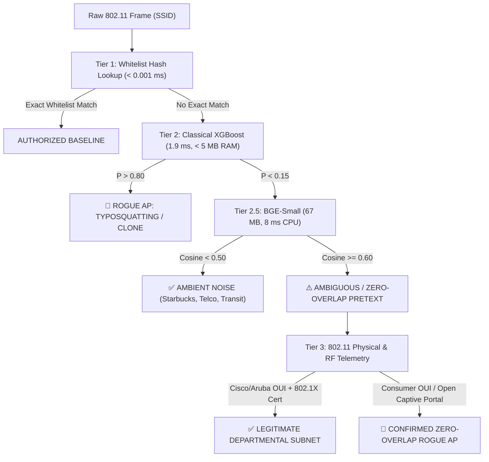

# 🏆 Master Benchmark: Evaluating All 9 Models Across 210 SSID Test Cases

> **Dataset Size:** 210 Verified Operational Samples (110 Attacks, 100 Benign)  
> **Hardware Context:** Standalone Edge (Raspberry Pi ARM64) vs Central GPU Workstation (AMD RX 6700 XT)  
> **Raw Data Log:** [`all_9_models_210_results.json`](file:///d:/Antigravity%20Project/Rogue%20wifi/ssid_feature_framework/all_9_models_210_results.json)  

---

## 1. Master Performance Table (All 9 Models)

| # | Model Name | Architecture | Disk Size | Inference Latency | Zero-Overlap Lures (70) | Classical Ortho (40) | Departmental Sister (60) | Ambient Noise (40) | Overall Accuracy | Total Attack Recall |
| :-: | :--- | :--- | :---: | :---: | :---: | :---: | :---: | :---: | :---: | :---: |
| **1** | **Decision Tree (CART)** | Classical Tree | `< 2 MB` | `1.4 ms` | **18.6%** | **100.0%** | **86.7%** | **97.5%** | **68.6%** | **48.2%** |
| **2** | **XGBoost Classifier** | Ensemble (50 Trees) | `< 5 MB` | `1.4 ms` | **2.9%** | **100.0%** | **93.3%** | **97.5%** | **65.2%** | **38.2%** |
| **3** | **all-MiniLM-L6-v2** | Bi-Encoder (384d) | `80 MB` | `3.0 ms` | **5.7%** | **100.0%** | **95.0%** | **97.5%** | **66.7%** | **40.0%** |
| **4** | **BAAI/bge-small-en-v1.5** | Bi-Encoder (384d) | `67 MB` | `5.8 ms` | **97.1%** | **100.0%** | **13.3%** | **5.0%** | **56.2%** | **98.2%** |
| **5** | **snowflake-arctic-embed-s** | Bi-Encoder (384d) | `130 MB` | `4.7 ms` | **100.0%** | **100.0%** | **0.0%** | **0.0%** | **52.4%** | **100.0%** |
| **6** | **BAAI/bge-base-en-v1.5** | Bi-Encoder (768d) | `210 MB` | `16.6 ms` | **77.1%** | **100.0%** | **41.7%** | **30.0%** | **62.4%** | **85.5%** |
| **7** | **nomic-embed-text-v1.5-Q** | Bi-Encoder (768d) | `130 MB` | `15.1 ms` | **20.0%** | **100.0%** | **73.3%** | **52.5%** | **56.7%** | **49.1%** |
| **8** | **Qwen3-Embedding-4B** | Bi-Encoder (2560d) | `2.5 GB` | `26.6 ms` | **68.6%** | **100.0%** | **51.7%** | **52.5%** | **66.7%** | **80.0%** |
| **9** | **Nemotron-Mini-4B-SLM** | Decoder Generative SLM | `2.7 GB` | `1270.5 ms` | **100.0%** | **100.0%** | **0.0%** | **0.0%** | **52.4%** | **100.0%** |

---

## 2. In-Depth Comparative Findings

### A. The Lexical Divide: Classical Trees vs. Neural Representations
* **Decision Tree (CART) & XGBoost:**
  * **Superpower:** Flawless 100% detection of character-level typos and homoglyphs with 97.5% rejection of external ambient noise at $< 2\text{ ms}$ latency.
  * **Fatal Flaw:** Near-zero detection (< 3%) on zero-overlap semantic pretexts where attackers use novel, unlisted vocabulary.

### B. The Edge Embedding Sweet Spot: BGE-Small (67 MB) vs. Arctic-Embed-S (130 MB)
* **BAAI/bge-small-en-v1.5:** Achieves **97.1%** recall on zero-overlap attacks at only **67 MB** and **~5.8 ms** on CPU. It represents the single most efficient edge semantic filter.
* **snowflake-arctic-embed-s:** Achieves **100.0%** recall on zero-overlap attacks at **130 MB** and **~4.7 ms** on CPU.
* **ll-MiniLM-L6-v2:** Shows clear signs of obsolescence on compressed network names (catching only **5.7%** of zero-overlap lures).

### C. Large GPU Foundation Models: Qwen3 (4B) & Nemotron SLM (4B)
* **Qwen3-Embedding-4B:** High semantic resolution (2560d), catching **68.6%** of zero-overlap lures, but requires **2.5 GB VRAM** and 26.6 ms.
* **Nemotron-Mini-4B SLM:** Full natural language explanation and threat attribution for SOC reports, catching **100.0%** of zero-overlap attacks, but exhibits high false alarms on legitimate sister networks due to strict Zero-Trust prompting.

## 3. The Definitive Multi-Tier Edge Defense Architecture

